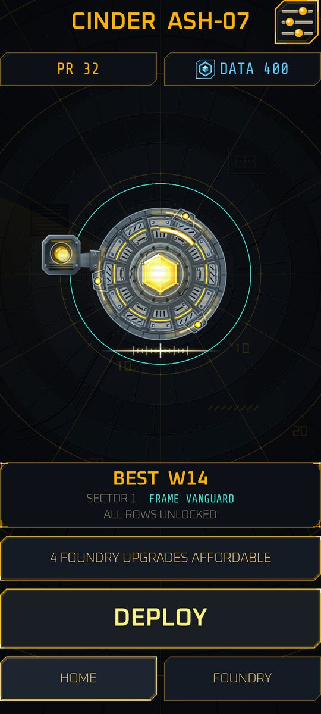
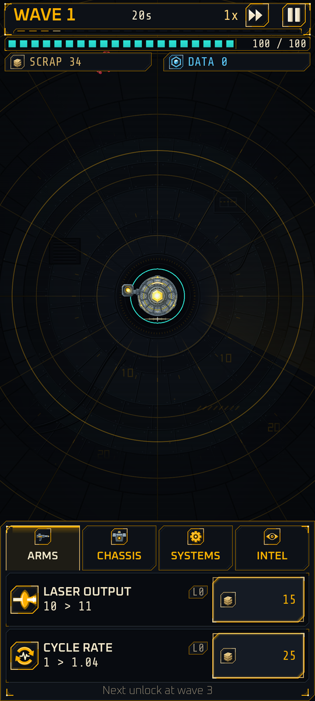
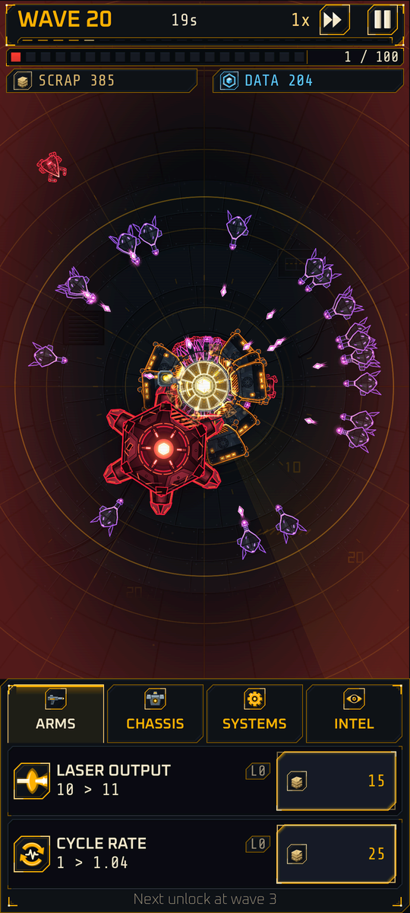
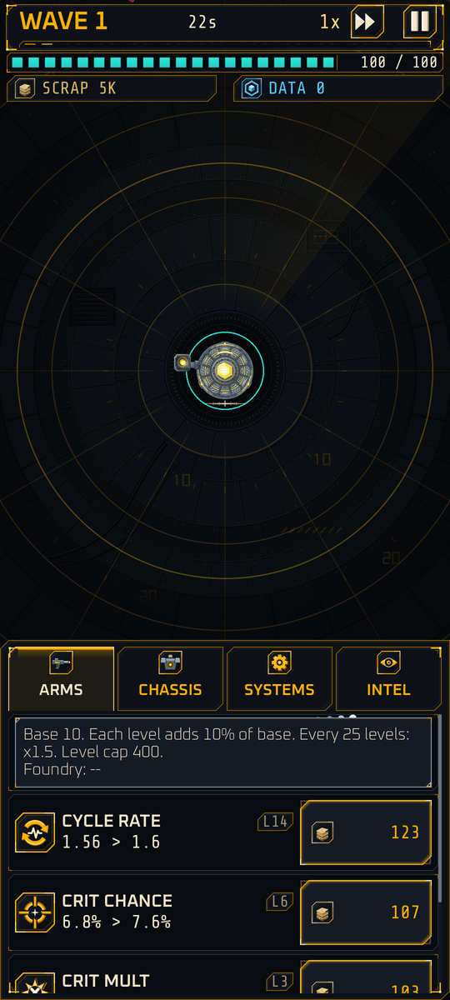
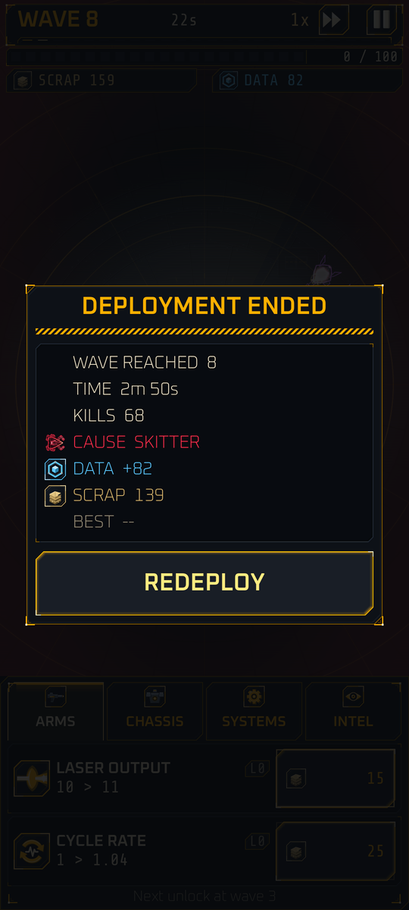
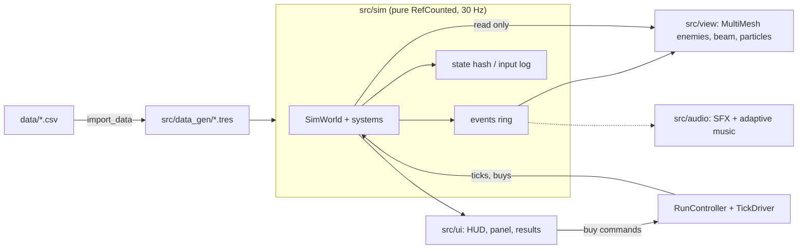

# IRON STATIC

Hold the last relay. Burn away what is left of being human. Go deeper every time.

IRON STATIC is an original portrait idle-defense game for Android, built with Godot 4.7.2. You are **Cinder**, a reprogrammed cybernetic combat unit fixed at the center of a circular arena. Rogue machine swarms close in from every side while Cinder auto-fires a hitscan laser. You spend salvaged scrap on temporary upgrades during a deployment, then spend recovered data in the Foundry on permanent ones so the next deployment goes deeper. The look is a dark industrial machine-vision HUD: amber, teal and red glow on black.

**Status (2026-11-09):** milestones M0, M1 and M2 are done. The V1 visual pass has landed apart from on-device verification, and the A1 audio pass is done. Milestone M3 (meta loop) is in progress: the title screen, Home, Foundry, three frames with a frame bay, Settings, crash-safe saving with resume and the early-curve rebalance are all in the build; on-device verification and the M3 exit check remain. Platform: Android, portrait. Items marked **Planned** below do not exist in the build.

| | | | |
|:-:|:-:|:-:|:-:|
|  |  |  |  |
| Title: the selected frame on a ridge | Frame bay: stat comparison and unlock goal | Home: best wave, data, DEPLOY | Foundry: permanent upgrades |
|  |  |  |  |
| Wave 1: calm start, ARMS tab | Wave 20: lancer crowd and the boss hulk, low integrity | Upgrade rows with a formula tooltip | Results after death |

*Captures of the current build at 1080x2400, downscaled (menu screens use test profiles). The wave 20 shot is a debug scenario (invulnerable, fast-forwarded), so the crowd mix is not what a real run looks like. The player-facing guide is the [codex](https://paimonsoror.github.io/iron-static/).*

## How it plays

### The run loop (implemented)

- A deployment is a series of **waves**. One wave is 24 s at 1x (720 sim ticks): enemies spawn on a ring outside the view, walk at Cinder and attack on contact (or from range). The next wave starts when the timer ends, whether or not enemies remain.
- Cinder sits at the center and auto-targets the nearest enemy in range with a laser. You never aim.
- Kills pay **scrap** instantly and bank **data** into the run total. Unspent scrap earns interest once you buy `reinvest`.
- Scrap buys temporary **run upgrades** in the bottom panel. Rows unlock by your best wave (shown as "Next unlock at wave N").
- When integrity hits 0 the deployment ends. The results screen shows wave reached, time, kills, cause of death, data banked (and the new total), scrap, and best wave with its gain, plus a FRAME UNLOCKED line when a threshold is crossed. REDEPLOY starts the next run with the next seed; FOUNDRY and HOME are beside it. Scrap is lost on death; data is banked and saved.
- A deployment starts with 60 scrap. Sector 1 has a boss hulk (8x HP) every 10 waves.

### Meta loop (implemented, M3)

- **Title screen:** CONTINUE (only when a save with progress exists), NEW GAME, SETTINGS, with the selected frame as the hero over a smoky wasteland, a glitching logo and a wind-and-metal ambience. NEW GAME on a profile with progress asks "START OVER?" and renames the old save to `.reset` copies (settings are kept).
- **Home:** Cinder, Power Rating, data, best wave, next unlock and DEPLOY. It shows a chip when Foundry upgrades are affordable.
- **Foundry** (after the first death): four permanent rows bought with data (Laser Output, Hull Integrity, Nano Repair, Cycle Rate), tap or hold to buy, a RECOMMENDED tag, a next-run Power Rating preview. Numbers live in `data/foundry.csv`.
- **Frames and the frame bay:** VANGUARD (baseline), BULWARK (tank, unlocks at best wave 8, passive Bastion) and STRIKER (glass cannon, best wave 15, passive Overclock). Frames are sidegrades, unlocked by play, and share the Foundry. The bay shows a stat comparison, the passive and the unlock goal; it opens from the FRAME chip on Home and from NEW GAME.
- **Settings:** sound, music, mute, reduce motion, screen shake, scanlines, number format and FPS cap, plus a Data section with a profile reset behind two confirmations.
- **Saving:** see "Under the hood". The run is checkpointed every 30 s and resumes paused after an app kill.

### Run upgrades (implemented, 10 rows)

Costs are `ceil(c0 * g^level)` (Laser Output and Hull Integrity: c0 10, g 1.108). Type D rows scale deeply with a x1.5 jump every 25 levels (Nano Repair gains 0.6 per level, the others 0.1); type C rows are linear with a hard cap. Numbers live in `data/run_upgrades.csv`.

| Tab | Upgrade | What it does | Base | Unlocks at best wave |
|---|---|---|---|---|
| ARMS | Laser Output | Damage per shot (D) | 10 | start |
| ARMS | Cycle Rate | Shots per second (C, cap 12) | 1.0 | start |
| ARMS | Crit Chance | Chance a shot crits (C, cap 85%) | 2% | 5 |
| ARMS | Crit Mult | Crit damage multiplier (C) | 1.5x | 8 |
| ARMS | Optic Range | Firing range in meters (C, cap 80) | 24 | 10 |
| CHASSIS | Hull Integrity | Max integrity; buying also heals that amount (D) | 100 | start |
| CHASSIS | Nano Repair | Integrity restored per second (D) | 1.0 | start |
| CHASSIS | Plating | Percent damage reduction (C, +6 points a level, cap 90%) | 0% | 10 |
| SYSTEMS | Scrap Yield | Multiplier on scrap gained (C, cap 3x) | 1.0x | 3 |
| SYSTEMS | Reinvest | Interest on unspent scrap at wave end (C) | 0% | 12 |

The **INTEL** tab is a stub today ("coming in a later update"). The GDD defines about 40 more rows (split shots, ricochet, razors, mines, repair pods and others); those are **Planned for M6**.

### Controls (implemented)

- **Tap the cost button** to buy 1 level. **Hold it** to repeat-buy: first repeat after 0.35 s, accelerating, then 10 levels per step after 3 s and 100 after 6 s. Partial buys are allowed when you cannot afford the full count.
- **Tap a row** to open its formula tooltip (base, step, caps, Foundry bonus).
- Top bar: wave and time left, **speed button** (1x / 2x) and **pause**. The sim supports up to 4x; the button offers 1x and 2x for now.
- **Android back gesture:** closes an open panel first, then pauses the battle, then quits.
- **App backgrounded:** the run pauses automatically and stays paused until you tap to resume.

### Enemies

Shape is the primary cue, an accent color the second. Hostile reads red or magenta against Cinder's amber and teal.

| Enemy | Role | Accent | First wave | Status |
|---|---|---|---|---|
| Skitter | Basic crawler, melee, the bulk of every swarm | red | 1 | Implemented |
| Dart | Fast thin drone that rushes Cinder | pink-magenta | 4 | Implemented |
| Lancer | Stops at range and fires a visible magenta bolt every 2 s | violet | 6 | Implemented |
| Walker | Slow, heavy, high HP, strong melee (takes 3 spawn slots) | orange | 8 | Implemented |
| Boss hulk | Heavy boss every 10 waves, 8x HP; reactor core glows white-hot | deep red | 10 | Implemented without the plate mechanic |

Hulk plates (damage reduction that falls off as the boss is hurt) are **Planned (M6)**, as are the support, stealth and elite enemies and three more bosses.

### Skin burn (implemented, visual)

Cinder's synthetic skin burns away as integrity drops, revealing the armored frame. Four bands (above 75%, 75-50%, 50-25%, below 25%) with 5% hysteresis so they do not flicker, plus ember particles, a low-integrity haze and a synced heartbeat in the worst band. The GDD's gameplay bonuses for the lower bands (extra damage and repair) are **Planned (M6)**.

### Novel mechanics

| Mechanic | Idea | Status |
|---|---|---|
| Skin burn | Integrity bands change Cinder's look | Visuals implemented; modifiers Planned (M6) |
| Adaptive swarm | The swarm resists your dominant damage type during a run | **Planned (M6)**, not in the sim |
| Salvage caches | Elites and bosses drop caches you can tap for a reward choice | **Planned (M6)**, not in the sim |
| Overdrive | Damage fills a meter; a button trades integrity for a burst of fire rate | **Planned (M6)**, not in the sim |
| Patch draft | Pick 1 of 3 run perks from wave 10 | **Planned (M4)** |

## Meta progression and economy

Five currencies at most: `scrap` (in-run), `data` (permanent), `flux`, `cipher`, `merit`. Only scrap and data exist in code today; data is saved with your profile.

- **Foundry** (permanent upgrades bought with data): implemented (M3), four rows; more rows come with later milestones.
- **Lab** (timed research, 48 h cap), weapon systems, firmware chips, companion drones: **Planned (M6)**.
- **Standby Patrol:** capped, partial-efficiency offline earnings of data only (about 4 h cap, rising to 11 h with Lab upgrades). **Planned (M6)**.
- **Free-to-play:** rewarded, opt-in ads only; no forced ads, no interstitials. Purchases are convenience-oriented, with disclosed odds for any chance-based pull. Billing, ads, backend and Gauntlet-style events are **Planned (M7 and later)**; the plugins are probed but stubbed behind interfaces.

Details: [`docs/design/04_economy.md`](docs/design/04_economy.md), [`05_meta_progression.md`](docs/design/05_meta_progression.md), [`06_monetization_liveops.md`](docs/design/06_monetization_liveops.md).

## Under the hood



**Deterministic simulation.** The sim runs at a fixed 30 Hz. It is pure `RefCounted` code (no nodes, input, clock or global random), enforced by `tools\lint.ps1`. Randomness goes through a per-stream PCG32 `Rng`. Entities live in packed-array stores with free lists, with no node per enemy or bullet. Game speed means more ticks per frame, never a longer tick. Every run produces a **state hash**, an **input log** (`tick, upgrade, count`) and a replay, and golden hashes in `tests/sim/test_replay.gd` catch any unintended behavior change. The same seed, config and inputs give the same hash at 1x, 2x or 4x.

**Numbers.** `BigNum` (immutable, text form like `1.5e12`) holds currency and cost values so late-game balances cannot overflow. `NumberFormat` is the only path to display, floors to 3 significant digits and uses a suffix table.

**Saving.** Profile and run saves are a single container: zstd-compressed payload with an HMAC-SHA256 signature over header and payload, so truncation, corruption and tampering are detected on load. Writes go to a temporary file and are swapped in atomically, the previous good file is kept as a backup and used when the main file fails its checks, and a damaged save raises a blocking "save problem" screen (files renamed `.corrupt`, never deleted). Saves are written after every banked run and Foundry or frame change and when the app is backgrounded; a run snapshot is checkpointed every 30 s of unpaused time and restored paused after an app kill. Schema versions are migrated forward with fixtures in `tests/fixtures/`; a snapshot from an older `SimVersion` is discarded rather than replayed. `src/save/` is pure code behind an injected filesystem interface.

**Data pipeline.** Balance and content live in `data/*.csv` (upgrades, enemies, sim constants, frames, Foundry rows, UI strings, targets). `tools\import_data.ps1` generates typed `.tres` resources in `src/data_gen/`, which are the only data read on a device. Generated files are never hand-edited.

**Rendering.** Compatibility (GLES3) renderer for broad Android support. Enemies are textured `MultiMesh` quads, one per type, with hit flash, flipbook frames and spawn-in driven by per-instance data. Glow uses premultiplied alpha so it costs one draw. The camera auto-fits so Cinder's whole laser range is always on screen. The beam is a strip renderer, death bursts and sparks use a pooled GPU particle ring, and the arena has an animated polar grid, radar sweep and vignette. Quality tiers HIGH/MID/LOW switch effects off in a fixed fallback order, and glow strength drops as the crowd gets denser. Screen shake and boss-death slow-mo are presentation-only and toggleable.

**Audio.** SFX and music are synthesized offline by deterministic Python scripts (`tools/audio_gen/`), not sampled. A bus layout (Master limiter, Music, SFX, UI) and voice caps keep the mix clean, and music is four stacked 8-bar loops in an `AudioStreamSynchronized` that fade in with wave number, boss presence and low integrity. Rules sit in `assets/audio/music_layers.csv`. The A1 audio pass is done: sound is wired to combat and UI events, and the menus have a wind and distant-metal ambience.

**Mobile handling.** Safe-area insets (notches, cutouts), pause on app lifecycle events, a pure back-gesture policy, a 30/60 fps cap, a shader warm-up pass at boot, and a layout checked on tall, wide and near-square windows.

## Art and audio sources

- **Art:** Claude-authored layered SVG sprites (Cinder, five enemies, bolt, FX sheet, UI kit, 25 icons, arena floor) in `assets/art/src/`. Every sprite sits in a named slot in [`assets/art/slots.csv`](assets/art/slots.csv), so a commissioned set can replace it file by file with no code change. SVGs are linted (`tools\art_lint.ps1`) and pixel-checked (`tools\art_check.ps1`). Direction: [`docs/design/10_art_bible.md`](docs/design/10_art_bible.md).
- **Audio:** original Claude-synthesized SFX and music layers in swappable slots ([`assets/audio/slots.csv`](assets/audio/slots.csv)); no samples. Sketch pack and notes: [`docs/playtests/a1/`](docs/playtests/a1/A1-01_sketch.md).
- **Fonts:** Oxanium (body and headings) and Share Tech Mono (numbers), both under the SIL Open Font License 1.1. Sources, hashes and license texts: [`assets/fonts/LICENSES.md`](assets/fonts/LICENSES.md).
- **GdUnit4** test framework (`addons/gdUnit4`): MIT License, copyright Mike Schulze (see `addons/gdUnit4/LICENSE`).
- Other bundled plugins (Play Billing, AdMob, Nakama client, Sentry) are listed in [`docs/setup/plugin_matrix.md`](docs/setup/plugin_matrix.md); check each addon folder for its license.

## Getting started

### Prerequisites

Windows 11 with PowerShell, working from a normal drive path (for example `C:\dev\tower`), not a `\\wsl$` path.

| Tool | Version |
|---|---|
| Godot (standard, GDScript) | 4.7.2 stable, plus export templates (pinned in `tools/GODOT_VERSION`) |
| JDK | 17 (Temurin) |
| Android SDK | cmdline-tools, Platform-Tools, Build-Tools 35.0.1 and 36.0.0, platform android-35 |
| Android NDK / CMake | 28.1.13356709 (r28b) / 3.10.2.4988404 |
| Python | 3.12 (lint, CI gate, audio tooling; `tools/requirements.txt`) |
| Emulator | AVD `tower_phone` (Android 35 x86_64, host GPU) |

Full install notes and troubleshooting: [`docs/setup/DEV_ENVIRONMENT.md`](docs/setup/DEV_ENVIRONMENT.md).

### First steps

1. Install the toolchain per `DEV_ENVIRONMENT.md` and clone the repo to a local drive.
2. Install the Gradle build template once: `.\tools\setup_android_template.ps1`.
3. Run `.\tools\lint.ps1` and `.\tools\test.ps1` to confirm the setup.
4. Start the emulator (`.\tools\run_emulator.ps1`, wait about 25 s after a cold boot) and deploy (below). The first launch has roughly 30 s of black screen while shaders compile.

The editor can also run the project directly on desktop (open `project.godot` in Godot 4.7.2). Debug-only launch args after `--`: `--debug-load --debug-load-wave=<n>` (fast-forwarded crowd), `--quality=high|mid|low`, `--shake=off|low|normal`.

### Commands

Run from the repo root in PowerShell. Judge Godot runs by the wrapper scripts' output, not exit codes.

| Task | Command |
|---|---|
| Tests | `.\tools\test.ps1` (`-Canary` proves failures are detected) |
| Lint (format, lint, layer rules, compile) | `.\tools\lint.ps1` |
| Format GDScript | `.\tools\format.ps1 [paths]` |
| CSV to `.tres` | `.\tools\import_data.ps1` |
| Export, install, launch | `.\tools\deploy_android.ps1 -ProjectPath C:\dev\tower -Package com.ironstatic.game -Preset IronStatic` |
| Emulator smoke test | `.\tools\smoke_android.ps1` |
| Headless sim runs | `.\tools\sim_run.ps1 -Runs 20 -Seed 1` |
| Balance run vs targets | `.\tools\balance_run.ps1 -Profile fresh -Waves 100 -Runs 20` |
| Sim perf bench | `.\tools\perf_bench.ps1 [-Check]` |
| Render SVGs to PNG | `.\tools\svg_render.ps1 [-Scale 2] <files>` |
| Art lint / pixel check | `.\tools\art_lint.ps1` / `.\tools\art_check.ps1` |
| Render all audio | `.\tools\audio_gen.ps1` |
| Start emulator | `.\tools\run_emulator.ps1` |

### Continuous integration

GitHub Actions (`.github/workflows/ci.yml`, Ubuntu 24.04) runs on every push to `main` and every pull request: repo rules, gdformat and gdlint, a compile gate with warnings as errors, the GdUnit4 suite through an output-parsing runner, a canary that proves the runner catches failures, and a runner self-test. No secrets or signing are involved. See [`docs/setup/ci.md`](docs/setup/ci.md).

### Repo layout

```
assets/        art/src (SVG sprites), audio (sfx, music, slot tables), fonts, shaders, icons
data/          CSV source of truth for numbers, enemies, upgrades, strings
docs/          design (GDD), ROADMAP, TECH_ARCHITECTURE, tasks, setup, playtests, readme
src/
  sim/         deterministic simulation (pure RefCounted)
  core/        run controller, tick driver, CSV importer, number formatting
  data_defs/   typed resource definitions      data_gen/  generated .tres (do not edit)
  view/        battle rendering: enemies, beam, particles, camera, Cinder rig
  ui/          HUD, upgrade panel, results, theme, mobile shell
  audio/       buses, SFX pool, adaptive music
  services/    ads and billing behind interfaces (desktop stubs)
  net/         offline backend stub
tests/         GdUnit4 unit and sim tests, fixtures, perf baseline
tools/         PowerShell and Python tooling (test, lint, deploy, balance, art, audio)
addons/        GdUnit4, Billing, AdMob, Nakama client, Sentry
```

### Documentation map

| What | Where |
|---|---|
| Game rules, numbers, glossary (source of truth) | [`docs/design/`](docs/design/00_overview.md) (GDD 00-10) |
| Technical decisions | [`docs/TECH_ARCHITECTURE.md`](docs/TECH_ARCHITECTURE.md) |
| Milestones and exit criteria | [`docs/ROADMAP.md`](docs/ROADMAP.md) |
| Agent-ready task files | [`docs/tasks/`](docs/tasks/) (M0, M1, M2, V1, A1, M3) |
| Toolchain and troubleshooting | [`docs/setup/DEV_ENVIRONMENT.md`](docs/setup/DEV_ENVIRONMENT.md) |
| Art direction | [`docs/design/10_art_bible.md`](docs/design/10_art_bible.md) |
| Title screen and frames | [`docs/design/11_title_and_frames.md`](docs/design/11_title_and_frames.md) |
| Player codex (source in `site/`) | [paimonsoror.github.io/iron-static](https://paimonsoror.github.io/iron-static/) |
| Open questions | [`docs/design/09_open_questions.md`](docs/design/09_open_questions.md) |
| Conventions, rules, gotchas | [`CLAUDE.md`](CLAUDE.md) |

## Roadmap

| Milestone | Goal | Status |
|---|---|---|
| M0 Foundation | Repo, tests, lint, export, plugin spike, CI | Done |
| M1 Core combat | Deterministic sim, auto-battle, 5 enemies, waves, skin-burn bands | Done |
| M2 In-run economy | Scrap, 10 upgrades, BigNum, panel, results, input log, balance runner | Done |
| V1 Visual pass | Layered SVG art, FX, particles, styled HUD, auto-fit camera, mobile hardening | Done apart from on-device verification |
| A1 Audio pass | Synthesized SFX and adaptive music | Done |
| M3 Meta loop | Data banking, Foundry, save and resume, title screen, frames | In progress: features landed; on-device verification and the exit check remain |
| M4 Patches and FTUE | Patch draft, Intel tab, damage numbers, haptics, settings, tutorial | Planned |
| M5 MVP validation | Balance, real-device performance, fun checks | Planned |
| M6 Launch content | Lab, weapon systems, firmware, drones, adaptive swarm, caches, overdrive, sectors, Standby Patrol | Planned |
| M7 Online and release | Accounts, cloud save, billing, ads, compliance, Play release | Planned |
| P1 / P2 | Gauntlets, events, Operation Pass; Cells and extras | Post-launch |

After the early-curve rebalance (SimVersion 2) the median death wave of a fresh profile is about 12, on the design target; 300 data of Foundry levels add about 4 waves, and BULWARK and STRIKER land within about 10% of VANGUARD (`docs/playtests/m3/balance_m3.md`). On a Pixel 11 Pro Fold the game holds 60 fps with 165 enemies on screen; the x86 emulator runs about 42-45 fps on the HIGH tier. Full detail: [`docs/ROADMAP.md`](docs/ROADMAP.md).

## License

No license has been chosen yet. The repository is private, so all rights are reserved by default. Third-party components keep their own licenses: Oxanium and Share Tech Mono (SIL OFL 1.1, `assets/fonts/`), GdUnit4 (MIT, `addons/gdUnit4/LICENSE`), and the other plugins under `addons/`.
