<p align="center">
  <a href="https://paimonsoror.github.io/iron-static/">
    
  </a>
</p>

<p align="center"><b>Hold the last relay. Burn away what is left of being human. Go deeper every time.</b></p>

<p align="center">
  An original portrait idle-defense game for Android, built with Godot 4.7.2.
</p>

<p align="center">
  <a href="https://paimonsoror.github.io/iron-static/"><b>Codex</b></a> ·
  <a href="https://paimonsoror.github.io/iron-static/lore/">Lore</a> ·
  <a href="https://paimonsoror.github.io/iron-static/systems/">Game systems</a> ·
  <a href="https://paimonsoror.github.io/iron-static/status/">Status</a> ·
  <a href="https://paimonsoror.github.io/iron-static/dev/">Under the hood</a> ·
  <a href="docs/ROADMAP.md">Roadmap</a>
</p>

<p align="center">
  <a href="https://github.com/paimonsoror/iron-static/actions/workflows/ci.yml"></a>
  <a href="https://github.com/paimonsoror/iron-static/actions/workflows/pages.yml"></a>
  
  
  
</p>

## Start here

| If you want to | Go here |
|---|---|
| See what the game looks like | [Screenshots](#what-it-is) below, or the [codex home](https://paimonsoror.github.io/iron-static/) |
| Learn how a deployment plays | [The run loop and waves](https://paimonsoror.github.io/iron-static/systems/run-loop/), [Run upgrades](https://paimonsoror.github.io/iron-static/systems/upgrades/), [Patch drafts](https://paimonsoror.github.io/iron-static/systems/patches/), [Intel](https://paimonsoror.github.io/iron-static/systems/intel/), [Enemies](https://paimonsoror.github.io/iron-static/characters/enemies/) |
| Read the story | [Lore](https://paimonsoror.github.io/iron-static/lore/) and [Cinder](https://paimonsoror.github.io/iron-static/characters/cinder/) |
| Know what works today and what is next | [Development status](https://paimonsoror.github.io/iron-static/status/) and the [roadmap](docs/ROADMAP.md) |
| Build it and run it on a phone | [Quick start](#quick-start) below, then [Building and tools](https://paimonsoror.github.io/iron-static/dev/building/) |
| Understand the code | [Architecture](https://paimonsoror.github.io/iron-static/dev/architecture/) |
| Read the design documents | [`docs/design/`](docs/design/00_overview.md) (the source of truth for rules and numbers) |
| Work on it with a coding agent | [`CLAUDE.md`](CLAUDE.md) (conventions and gotchas) and [`docs/tasks/`](docs/tasks/) (agent-ready tasks) |

## What it is

You are **Cinder**, a reprogrammed cybernetic combat unit fixed at the center of a circular arena. Rogue machine swarms close in from every side while Cinder fires its laser on its own. You never aim: you choose what to buy. Scrap from kills buys temporary upgrades during a deployment; data recovered from the wreckage buys permanent upgrades in the Foundry, so the next deployment goes deeper. As Cinder's integrity drops, its synthetic skin burns away and exposes the armored frame beneath. The look is a dark machine-vision HUD: amber, teal and red glow on black.

| | | | |
|:-:|:-:|:-:|:-:|
| 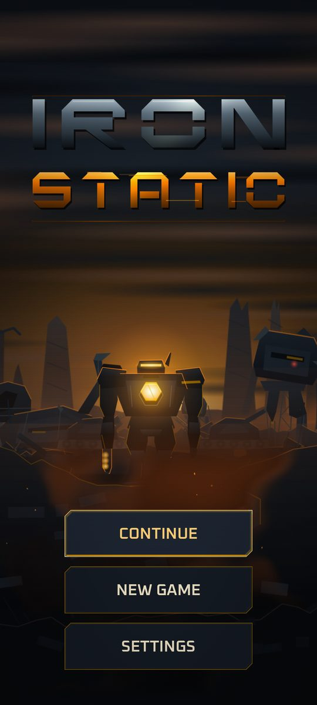 | 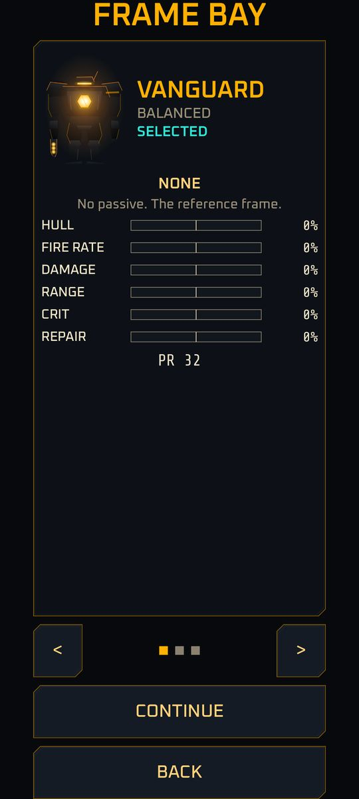 | 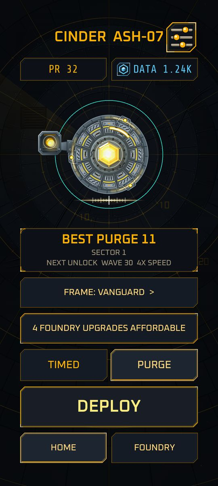 | 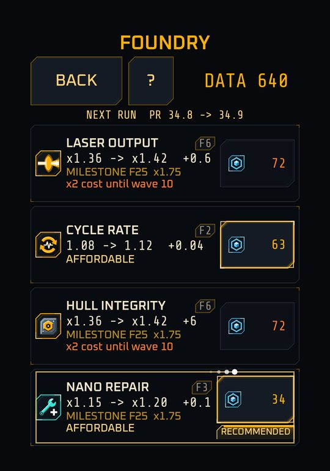 |
| Title screen | Frame bay | Home, with the wave mode picker | Foundry, with rows over the soft cap |
| 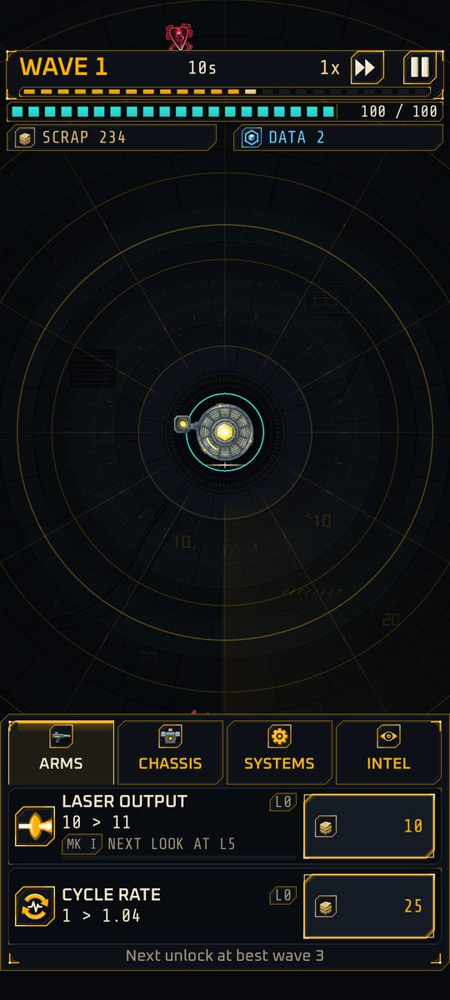 | 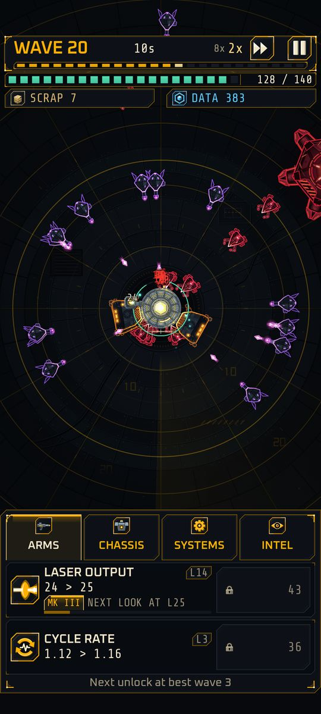 | 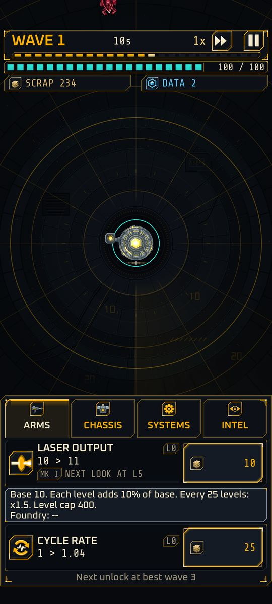 | 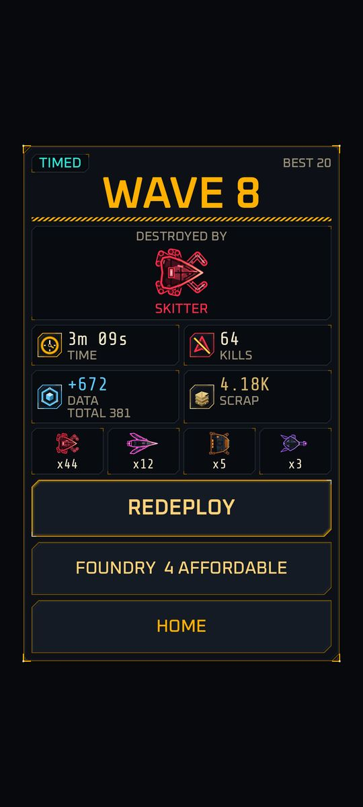 |
| Wave 1 | Wave 20 and the boss hulk | Upgrades and a formula tooltip | Results |

<sub>Captures of the current build, rendered on a desktop at 1080x2400 (a phone-sized screen) and downscaled. Menu screens use test profiles. The wave 20 shot is a debug scenario: an invulnerable Cinder played by a bot, with the 8x speed setting forced on (the top bar shows the fall-back to 2x while a boss is alive).</sub>

**New since M3** (patch draft, Intel, skin burn, guided first runs, damage numbers, results):

| | | | |
|:-:|:-:|:-:|:-:|
| 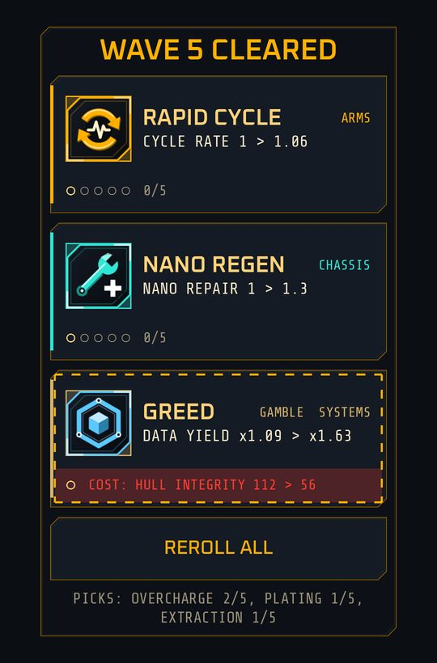 | 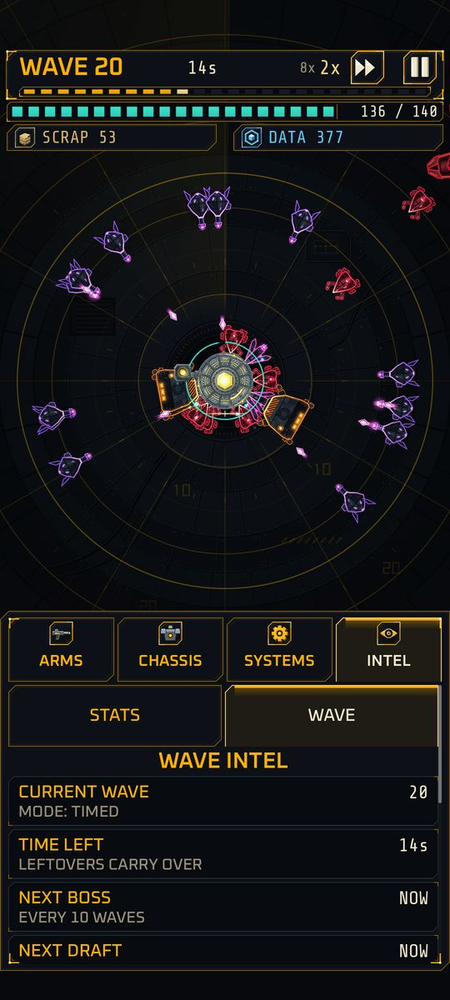 | 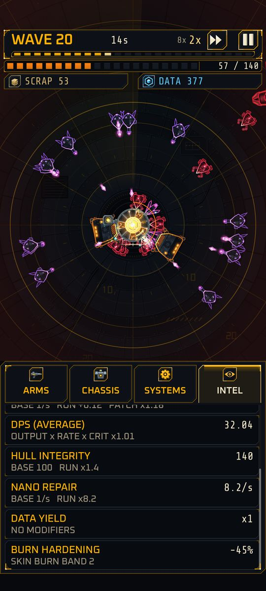 | 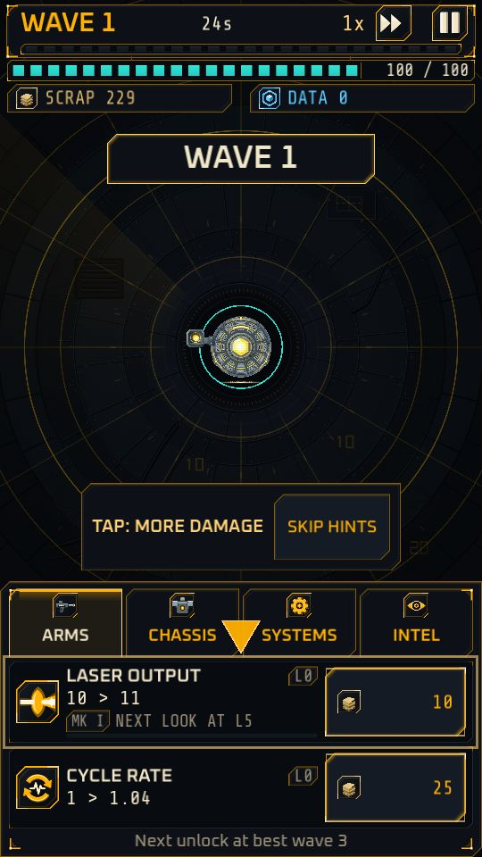 |
| Patch draft: one card per family, one reroll, a gamble | Intel, the WAVE panel | Skin burn band 2, and Intel's BURN HARDENING row | A guided first run |
| 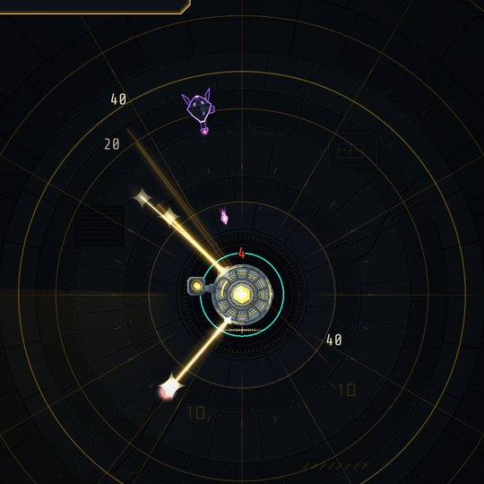 | 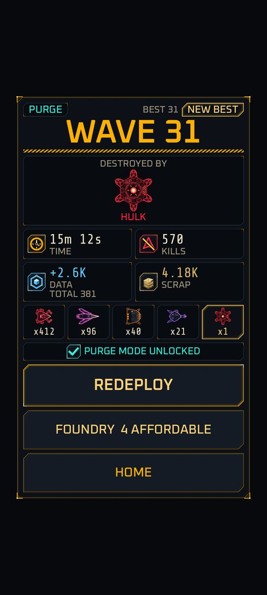 | 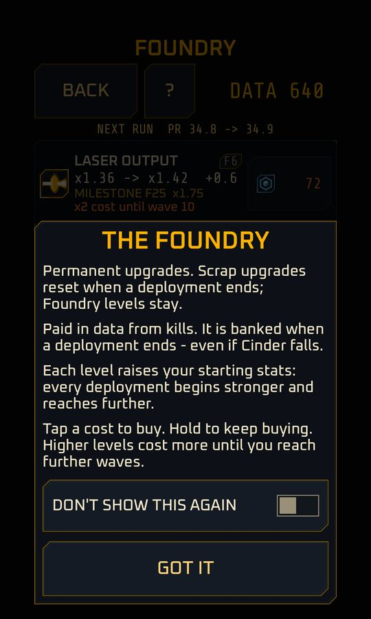 | 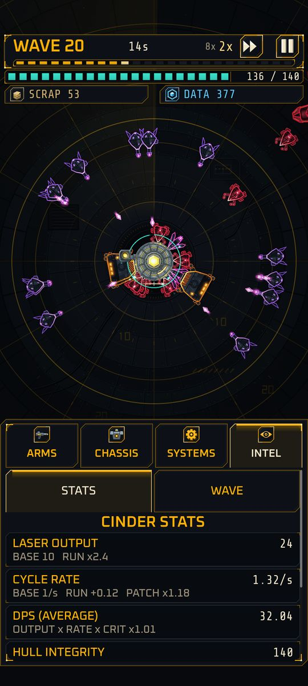 |
| Damage numbers and beam afterglow | Results with NEW BEST | The Foundry explainer | Intel, the STATS panel |

<sub>The draft is shown over a plain backdrop and the numbers shot is a debug scenario (an invulnerable Cinder at wave 9). The first-run capture is at window resolution on a fresh in-memory profile.</sub>

**Upgrades change how Cinder looks.** The laser beam at Laser Output MK I to IV (run levels 0, 5, 12, 25), and the hull plates at Hull Integrity MK I to IV:

<p align="center">
  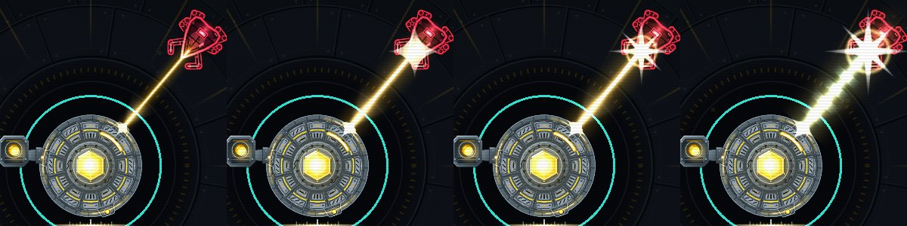
  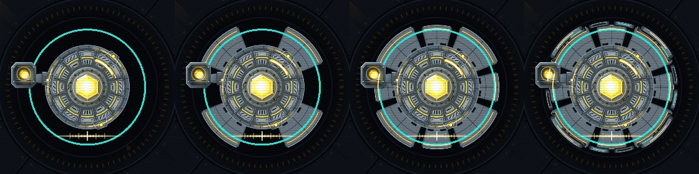
</p>

**In the build today:** 24-second waves of four enemy types plus a boss hulk every ten waves, in two wave modes (TIMED, and PURGE where a wave ends when its enemies are destroyed); ten run upgrades with tap and hold-to-buy and MK I to IV looks; patch drafts at waves 5, 10, 15 and 20 and later, with a reroll and gambles; the Intel tab; damage numbers; skin burn that also hardens the frame; speeds up to 8x with an automatic fall-back to 2x; the title screen, Home, the Foundry (with a best-wave soft cap), the Service Record of lifetime stats (time played and machines destroyed by type), three frames (VANGUARD, BULWARK, STRIKER) and Settings with haptics, colorblind and high-contrast modes and a local play summary; guided first runs; crash-safe saving with resume after the app is killed; synthesized sound and adaptive music. Every system, with its numbers and status, is in the [codex](https://paimonsoror.github.io/iron-static/systems/).

## Status

Milestones M0 to M3 are done, along with the V1 visual pass and the A1 audio pass. **M4's features are built**: the wave modes, the patch draft, the Intel tab, damage numbers, haptics, the guided first runs and the upgrade visual tiers. Its exit check (M4-28) is running, so the milestone is not closed yet. **R1 Phase A**, a feel pass that followed an independent review, is merged: the draft rework, speeds up to 8x, burn hardening, the Foundry soft cap, beam afterglow, a local play summary and readable text. **Next is a phone playtest with five to eight people**, then the open beta track on Google Play.

| Milestone | Goal | Status |
|---|---|---|
| M0 to M2 | Foundation, deterministic combat, in-run economy | Done |
| V1 / A1 | Visual pass / audio pass | Done |
| M3 | Meta loop: Foundry, saving and resume, title screen, frames | Done |
| M4 | Wave modes, patch draft, Intel, feel, first-time experience | Features built; exit check running |
| R1 | Review follow-up: the feel pass | Phase A merged; phone playtest next |
| M5 to M7 | MVP validation, launch content, online and release | Planned |

On a Pixel 11 Pro Fold the game held 60 fps with 165 enemies on screen in the last device measurement. Details: [development status](https://paimonsoror.github.io/iron-static/status/) and [`docs/ROADMAP.md`](docs/ROADMAP.md).

## Quick start

Windows 11 with PowerShell, Godot 4.7.2 with export templates, JDK 17 and the Android SDK and NDK. Clone to a normal drive path such as `C:\dev\tower` (not `\\wsl$`). Exact versions and install notes: [Building and tools](https://paimonsoror.github.io/iron-static/dev/building/) and [`docs/setup/DEV_ENVIRONMENT.md`](docs/setup/DEV_ENVIRONMENT.md).

```powershell
.\tools\setup_android_template.ps1   # once: install the Gradle build template
.\tools\lint.ps1                     # format, lint, layer rules, warnings-as-errors compile
.\tools\test.ps1                     # the GdUnit4 suite
.\tools\run_emulator.ps1             # start the emulator, then deploy:
.\tools\deploy_android.ps1 -ProjectPath C:\dev\tower -Package com.normalexception.games.ironstatic -Preset IronStatic
```

You can also open `project.godot` in Godot 4.7.2 and run it on the desktop. Every other tool (balance runs, perf bench, art and audio pipelines, save inspection) is listed on the [Building and tools](https://paimonsoror.github.io/iron-static/dev/building/) page.

## Documentation

| What | Where |
|---|---|
| Player codex: lore, characters, every system | [paimonsoror.github.io/iron-static](https://paimonsoror.github.io/iron-static/) (source in [`site/`](site/)) |
| How it is built | [Under the hood](https://paimonsoror.github.io/iron-static/dev/) |
| Game rules, numbers, glossary (source of truth) | [`docs/design/`](docs/design/00_overview.md) |
| Technical decisions | [`docs/TECH_ARCHITECTURE.md`](docs/TECH_ARCHITECTURE.md) |
| Milestones and exit criteria | [`docs/ROADMAP.md`](docs/ROADMAP.md) |
| Open questions | [`docs/design/09_open_questions.md`](docs/design/09_open_questions.md) |
| Art, audio and font sources | [Credits and sources](https://paimonsoror.github.io/iron-static/dev/credits/) |

## License

No license has been chosen yet, so all rights are reserved by default. Third-party components keep their own licenses: Oxanium and Share Tech Mono (SIL OFL 1.1, `assets/fonts/`), GdUnit4 (MIT, `addons/gdUnit4/LICENSE`), and the other plugins under `addons/`.
