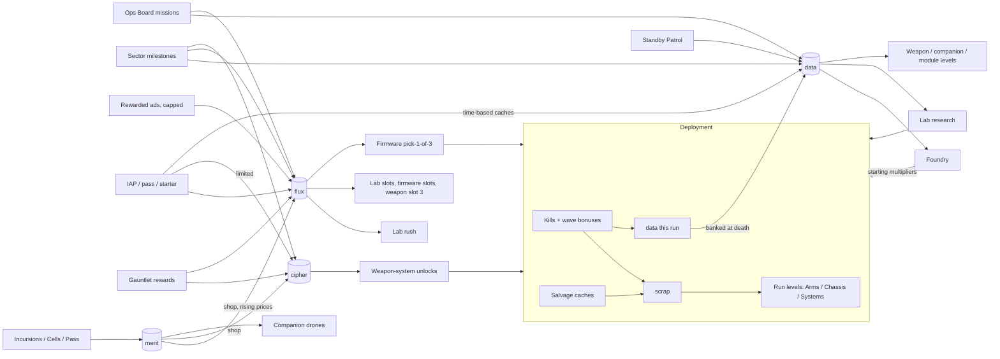

# 04 - Economy

Changelog: 2026-11-07 - Standby Patrol (section 4) approved by the user; number type (section 5) changed to BigNum for currency/cost values; Gauntlet-related sources are P1 (06 section 0).

Citations: `[ECON n]` = economy_monetization_liveops.md section n; `[META]` = meta_progression_systems.md. Target: **5 currencies**. The Tower has about 10 (Cash, Coins, Gems, Power Stones, Medals, Elite Cells, Keys, Tokens, Bits, Shards) [ECON 1]; "too many currencies for too many purposes" is a repeated complaint [ECON 7]. All earn-rate targets are first-pass and tunable; the later headless simulation must reproduce the cumulative targets in section 3.

---

## 1. Currency list

| id | Persist | Primary purpose | Soft/hard |
|---|---|---|---|
| `scrap` | Run only | Run upgrades | soft, never sold |
| `data` | Permanent | Foundry, Lab, weapon-system / companion / module levels | soft, sold only as time-based "caches" |
| `flux` | Permanent | Rush timers, lab slots, firmware picks, firmware slots, cosmetics | hard, earnable (ads, missions) and sold |
| `cipher` | Permanent | Unlock weapon systems, companion upgrades (late) | scarce, tournament/milestone driven; sold in limited monthly packs |
| `merit` | Permanent (shop prices reset per season/event) | Incursion shop, Cell shop, Operation Pass shop | social/live, not sold |

Merged-away currencies (mapping for the dev team): Elite Cells -> replaced by `flux` rush + `data`; Keys/Vault -> out of scope; Bits/Tokens -> `merit`; Module shards, reroll shards -> removed (3-to-1 module fusion, rerolls cost `data`); Medals -> `merit`.

## 2. Sources, sinks, and rules per currency

### 2.1 `scrap` (run currency) [CIS 3]
- Sources: enemy kills (03 section 3), wave-end bonus (`scrap_per_wave`), interest (`reinvest`), salvage caches (`cache_scrap` pays `10 x scrap_per_kill(l)` of a skitter), `patch_t_hoard`.
- Sinks: in-run upgrade levels (02).
- Rules: starts at 20 (+Lab `start_scrap` +2 per level, max +100); lost at run end; no cap; interest cap per 02 `reinvest`.

### 2.2 `data` (permanent soft currency) [CIS 3 coins]
- Sources: kills (03 section 3), `data_per_wave`, sector milestones, Ops Board missions, Standby Patrol, convoy kills, tournament rewards (small), Incursion/Operation Pass rewards, data caches (IAP).
- Sinks: Foundry levels and unlocks (05), Lab research costs, weapon-system levels, companion levels, module levels, firmware merge? (no; duplicates are free), module rerolls (Post-launch).
- Rules: no cap; banked fully at run end (including death). Stale kills pay 50%.
- `farm_rate_1x` (used by missions, Standby Patrol, caches): `data` per **game-minute at 1x** = exponential moving average (weight 0.4) of `data_run / run_game_minutes` over the last completed runs of the player's **farm sector** (the highest sector with at least 20 waves cleared this week by default; player can override).

### 2.3 `flux` (premium-adjacent) [ECON 1 gems]
- Free sources (see rates in 2.3.1): rewarded ads, daily missions, weekly Ops Board chest, sector milestones (one-time), first-clear log-fragment sets (one-time), floating `flux_orb` in runs (cap 3/day), day-streak chest, Gauntlet top ranks (small), Operation Pass free track, event rewards, convoy cache (Post-launch).
- Paid: IAP flux packs, starter pack, Operation Pass premium track.
- Sinks: lab rush (3 `flux` per remaining hour, rounded up, free under 10 minutes), lab slots 3 and 4 (250 / 700), firmware pick-1-of-3 (45), firmware slots 4-8 (100, 200, 350, 550, 800 = 2,000), weapon-system slot 3 (400), extra loadout presets (Launch, 100 each, 3), mission reroll (5), Foundry respec of a stat group (Launch, 150), cosmetics (400-1,200), pass tier skip (20 per tier).
- Rules: no cap. Never converted from other currencies except `merit` shop packs (price rising: 40, 65, 90, 130, 175 merit for 60 flux, resetting per season). [ECON 1 event shop pattern, changed so a season can pay at most 60 x 5 = 300 `flux`.]
- Fairness: `flux` cannot buy: tournament entries, direct `data`/`cipher`, or any stat. It only buys time, convenience slots and firmware picks.

#### 2.3.1 Free `flux` income model (per day, an engaged free player)
| Source | Amount | Daily cap |
|---|---|---|
| Rewarded ads `ad_flux_claim` (6 claims x 8) | 48 | 6 claims |
| Daily missions (3 x 5) | 15 | 3 |
| Day-streak chest (average) | 5 | 1 |
| Weekly chest (70 / 7) | 10 | 1/week |
| In-run `flux_orb` (2 each, max 3/day) | 6 | 3 |
| **Total (maximum free)** | **~84/day** | |
Typical engaged free: ~60/day. Casual (1-2 sessions): ~25/day. Compare [ECON 1]: The Tower maximum ~410 gems/day with 6 gems per ad and a 24 h lab rush ~180 gems; ours: 24 h rush = 72 `flux` ~ 0.9 day of max free income. Intent: a free player can rush one long lab per day or buy one firmware pick every 0.5 day, but not everything.

### 2.4 `cipher`
- Sources: Gauntlet rewards (main), sector milestones (one-time), Incursion final-tier reward, Operation Pass free + premium track, `merit` shop (price rising 60, 100, 160, 240, 340 merit for 10 cipher, resets per season), IAP (limited): `cipher_pack_s/m/l` (max 3 purchases per account per month).
- Sinks: weapon-system unlock (cost by order owned: 3, 20, 60, 120, 220, 380, 600, 900, 1,300; total 3,603), companion unlock (via `merit`, see 05) and "plus" upgrades (Post-launch: 5 per companion level beyond 5), firmware rank-up exceptions none.
- Rules: no cap. Intentionally scarce; free earning model: week 1 ~15, month 1 ~150, month 6 ~2,500 (all weapon systems about month 8-10 free). [ECON 1 Power Stones]

### 2.5 `merit`
- Sources: Ops Board weekly chest (10), daily mission set (4/day), Incursion mission tiers (10/15/20 per mission), Cell weekly chest, Cell contributions, Operation Pass.
- Sinks: Incursion shop (flux packs, cipher packs, cosmetic, companions), Cell shop, Operation Pass shop; shop prices reset each event/season so hoarding is capped. [ECON 1 event shop price ladder]
- Rules: persists across seasons up to a soft cap of 1,500 held (excess converts to `data` 1:20 farm-minutes).

## 3. Target earn rates for free players (first-pass)

Assumed play: engaged free player, 3 sessions/day, ~35 minutes active play/day, using 2x speed. Cumulative values are **earned**, not held. Day 1 = first 24 h, W1 = first 7 days, M1 = first 30 days, M6 = first 180 days.

| Currency | Day 1 | Week 1 | Month 1 | Month 6 | Notes |
|---|---|---|---|---|---|
| `data` (cumulative) | 6e3 | 3e5 | 2e7 | 1e10 | grows ~x50 per period because sector `R(s)` and enemy level rise; first-run ~190 |
| `flux` (cumulative) | 150 | 700 | 2,400 | 13,000 | D1 includes ~60 tutorial/starter bonus |
| `cipher` (cumulative) | 0 | 15 | 150 | 2,500 | Gauntlet unlocks at S1 w60, about day 4 |
| `merit` (cumulative) | 0 | 20 | 500 | 5,000 | Incursions unlock at S1 w70 |
| Foundry levels (avg of 8 core stats) | 14 | 55 | 100 | 185 | cost `20 * 1.1^F` per level |
| Typical best sector/wave | S1 w40 | S2 w45 | S5 w50 | S9 w120 | see 03 section 6 (to be re-validated) |

Intended pacing checks:
- A new player can spend all of first-session `data` (~800) in the Foundry on 2-3 stats and feels the difference on the next run (design target: +4 waves per ~300 `data`).
- By week 1 a free player has not bought out firmware slots or the full weapon set; both extend over months.
- A spender buying ~$10/month can buy about 1,100 `flux`: roughly one extra lab slot + 12 firmware picks or ~370 hours of rush. This is speed and convenience, not exclusive power (see 06 fairness rules).

### 3.1 Sector milestone rewards (one-time, free track)
Ladder waves per sector: `m` in {10, 20, 30, 50, 75, 100, 150, 200, 300, 400, 500}.
| m | `flux` | `cipher` | `data` |
|---|---|---|---|
| 10 | 0 | 0 | 25 x R(s) x m^1.5 |
| 20 | 5 | 0 | same formula |
| 30 | 5 | 0 | |
| 50 | 10 | 0 | |
| 75 | 10 | 2 | |
| 100 | 20 | 3 | |
| 150 | 20 | 4 | |
| 200 | 30 | 5 | |
| 300 | 40 | 8 | |
| 400 | 50 | 10 | |
| 500 | 60 | 12 | |
Per sector totals: 250 `flux`, 44 `cipher`. Over 12 sectors: 3,000 `flux`, 528 `cipher`. A one-time Milestone Premium (`milestone_plus`, 06) doubles `data` and `flux`, x1.5 `cipher`. [CIS 5; ECON 3 premium milestones. Changed: our premium is x2 not x10.]

### 3.2 Missions (Ops Board; see 06) reward formula
- Daily mission (3 per day): `data = farm_rate_1x * 20` (20 game-minutes of farming), 5 `flux`, 1-2 `merit`. [ECON: coins scale with tier]
- Weekly Ops chest (5 missions): `data = farm_rate_1x * 240`, 70 `flux`, 10 `merit`, 1 firmware pick-1-of-3 (free).

## 4. Idle and offline: Standby Patrol (APPROVED 2026-11-07, tag Launch) [ECON 2: The Tower has no confirmed offline earnings; this is our addition]

Status: approved by the user as specified below (about 25% of the recent active rate on average, 4 h base cap rising to 11 h, optional ad to double). Offline time must come from the trusted clock rules in TECH_ARCHITECTURE section 5.5; 09 Q32 notes the parameter wording.

While the app is closed (or backgrounded for more than 60 s), Cinder runs a Standby Patrol in the player's selected patrol sector (default: farm sector).
```
standby_data = farm_rate_1x * patrol_minutes * efficiency
patrol_minutes = min(minutes_away, cap_minutes)
```
| Parameter | Base | Lab upgrade | Max |
|---|---|---|---|
| `cap_minutes` | 240 (4 h) | Lab `standby_cap`: +30 min per level, 14 levels | 660 (11 h) |
| `efficiency` | 0.20 | Lab `standby_eff`: +0.01 per level, 20 levels | 0.40 |
- Standby earns **only `data`** (no `scrap`, `flux`, `cipher`, `merit`, drops, caches, milestones). It does not advance best wave or tournaments.
- On return a modal shows time away, data gained and an opt-in "Double (watch ad)" button (`ad_offline_double`, 2/day). No guilt text.
- Because `farm_rate_1x` is game-minutes at 1x while active play is typically at 2x, Standby at 20% is about 10% of an equal wall-clock active session: intent is "reward returning, not replace playing".
- Lab research timers, event timers and tournament timers run in real time regardless.
- Tamper rule: use server time for the claim when online; if only local time is available, cap the claim at base `cap_minutes` (240). Full rules (monotonic clock, `clock_tamper` flag, timers frozen not punished, idempotent claims) are in TECH_ARCHITECTURE section 5.5.
- Idle sessions are not simulated in detail; Standby Patrol is a closed-form payout (no run is simulated), so cost is trivial. Runs themselves pause when the app is backgrounded.

## 5. Big-number format (HARD)
- Internal type (changed 2026-11-07, 09 Q5): **BigNum** (mantissa + base-10 exponent, persisted as a string) for `scrap` and `data` balances, all cost values and reward payouts, from ROADMAP M2; `flux`, `cipher`, `merit` are 64-bit integers; stat values and per-tick combat math stay IEEE double. Rounding: numbers are floored when displayed (never rounded up on rewards). Costs display exactly the cost used.
- Display rules:
  1. `0 .. 999`: integer, no decimals (`847`).
  2. `1,000 .. 999,999`: suffix `K` with up to 3 significant digits (`12.4K`, `847K`).
  3. Suffix ladder (names): `K`, `M`, `B`, `T`, `Qa`, `Qi`, `Sx`, `Sp`, `Oc`, `No`, `Dc` (up to 1e33). Above 1e36, scientific: `1.23e45`.
  4. Always 3 significant digits; trim trailing zeros (`1.5K`, `15.0K` -> `15K`).
  5. Percentages: 1 decimal below 10%, integer above; multipliers `x1.25`, `x12.4`, `x1.24K`.
  6. Time: `45s`, `12m 30s`, `3h 05m`, `1d 4h`.
- Setting: "Number format" (Short suffix / Scientific / Engineering) in Settings. Default Short.
- Affordability coloring: cost text in amber when affordable, dim gray when not; never red (red means hostile).

## 6. Currency flow diagram



ASCII summary:
```
 KILLS ──> scrap ──> run upgrades (resets)
   │
   └─> data ─┬─> Foundry ─┐
 Standby ───┤            ├─> starting power for next deployment
 Missions ──┤──> Lab  ───┤
 Milestones ┘   Weapons ─┘
 ads/IAP/missions ──> flux ──> rush, slots, firmware picks
 Gauntlet/milestones ─> cipher ──> weapon-system unlocks
 events/Cells/pass ───> merit ──> shops (flux/cipher/drones)
```

## 7. Anti-inflation and sanity rules
- Foundry cost per level `20 * 1.10^F` (03/05) while per-run `data` grows with sector and level: keep time-to-next-level between 5 min (early) and ~1 day (F>150).
- `flux` is never generated from `data` or `scrap`, so inflation cannot leak from the soft economy.
- Weekly cap on free `flux` from ads (6 claims/day x 8 = 48; hard 12 total rewarded views/day across all placements in 06).
- Hard caps on anything multiplicative: `scrap_yield` base cap 3.0 in-run; external multipliers are limited by firmware slot count (max 8 equipped) and module slots (4).
- All reward tables are data files; changing them must not require a client update (yes, via the remote-config overlay for numeric tables, TECH_ARCHITECTURE section 4.3).
