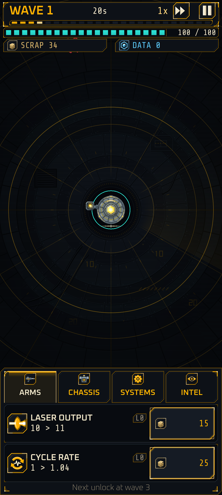
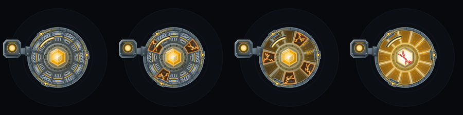

# Cinder

**Serial ASH-07. Warden-class cybernetic organism. Reprogrammed to hold the Relay.**

Cinder is the only thing you control, and you do not control it directly. It stands fixed at the center of the arena and fires on its own. You decide what it becomes.

{ width="260" }

## Starting stats Implemented

Every deployment begins here, before any permanent upgrades:

| Stat | Starting value |
|---|---|
| Laser output | 10 damage per shot |
| Cycle rate | 1.0 shots per second |
| Range (optic range) | 24 meters |
| Crit chance and multiplier | 2 percent, x1.5 |
| Integrity (hit points) | 100 |
| Nano repair | 1 integrity per second |
| Hit radius | 2.0 meters |
| Scrap | 20 |

A wave 1 skitter has 14 hit points, so it takes two shots. The first upgrade, laser output level 1, costs 10 scrap and is affordable from the starting 60.

## Behavior

- **Auto-fire.** Cinder fires at the nearest enemy inside its range, re-choosing on every shot. There is no target lock and no aiming. See [Combat](../systems/combat.md).
- **Stationary.** Cinder never moves. Enemies come to it.
- **Silent.** Cinder reports in system lines such as `SKIN INTEGRITY 62%` and never speaks. Even between waves its visor slowly tracks a target.

## Look

Cinder is drawn top-down and has to read at a glance, even in a crowd:

- A hexagonal chest core, pulsing amber-white, always the brightest thing on screen.
- A slit visor line, never eyes.
- A rotating ring of three emitter nodes; the laser leaves from the active one.
- An asymmetric emitter on the left shoulder.
- Plated armor over a gunmetal frame, which [burns away](../systems/skin-burn.md) as integrity falls.

## Origin

Where Cinder came from, and who rewrote it, is on [Cinder and the Wardens](../lore/cinder-origin.md).

## Frames

Cinder deploys in one of several [frames](frames.md), each stronger in one way and weaker in another.
