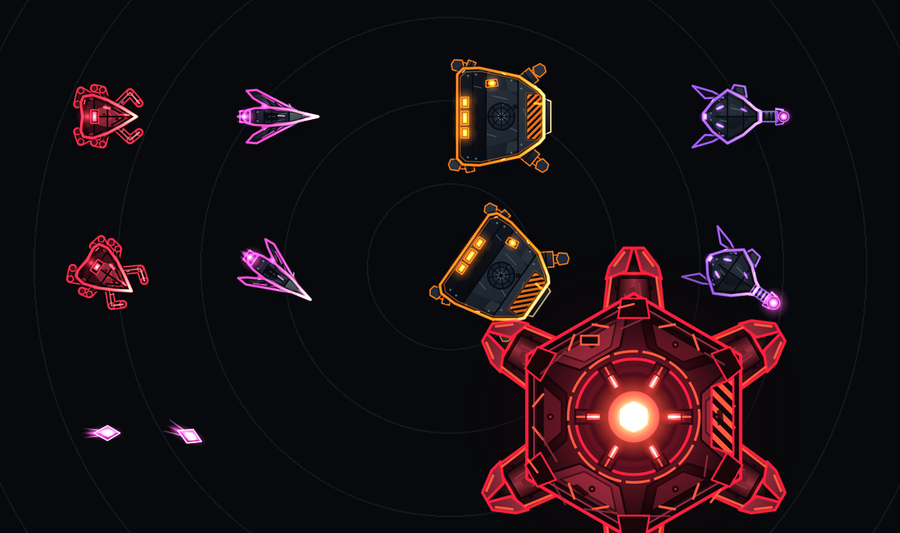
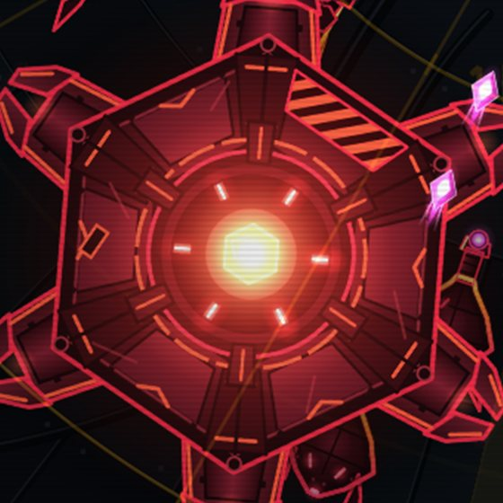

# Enemies

Every enemy is a machine of CHORUS. **Shape is the main cue and color is the second**: you should be able to tell what is coming from its silhouette before you read its color. Hostile units read red or magenta against Cinder's amber and teal, and **magenta is reserved for enemy fire**.

*Left to right: skitters, darts, walkers, lancers and the boss hulk, with magenta lancer bolts at bottom left.*

## In the game today Implemented

Multipliers apply to the base enemy values at the current enemy level. Speed is in meters per second.

| Enemy | Accent | Role | Speed | Health | Damage | Slots | First wave |
|---|---|---|---|---|---|---|---|
| [Skitter](#skitter) | red | Basic crawler | 3.5 | x1.0 | x1.0 | 1 | 1 |
| [Dart](#dart) | pink-magenta | Fast rusher | 7.35 | x0.8 | x0.8 | 1 | 4 |
| [Lancer](#lancer) | violet | Ranged | 4.2 | x1.0 | x1.2 | 1 | 6 |
| [Walker](#walker) | orange | Heavy melee | 2.1 | x5.0 | x1.5 | 3 | 8 |
| [Boss hulk](#boss-hulk) | deep red | Boss | 1.4 | x25 | x3.0 | 1 | 10 |

"Slots" is how much of a wave's spawn budget an enemy costs; see [The run loop](../systems/run-loop.md#how-many-enemies-spawn).

Rewards per kill scale with enemy level. Scrap is multiplied by x1.0 (skitter), x1.5 (dart, lancer), x3.0 (walker) and x5.0 (boss hulk); base data is 1, 2, 2, 4 and 15 respectively. See [Economy](../systems/economy.md).

### Skitter

The scrapper crawler and the bulk of every swarm. It walks straight at Cinder and attacks on contact once per second. It is drawn as a small triangle with three thin legs a side.

*Counter:* anything. Spread-out damage and sturdy hulls handle skitters easily; their danger is numbers.

### Dart

A thin, fast aerial drone. It rushes Cinder and attacks on contact. It is a chevron with a trailing wake.

*Counter:* a higher fire rate and more range, so you hit it before it arrives.

### Lancer

A ranged unit that stops at a stand-off distance and fires a visible **magenta bolt** every 2 seconds. The stand-off distance is 85 percent of your optic range, never closer than 16 meters and never farther than 48. It is a diamond with a long barrel line.

*Counter:* range. Because lancers hold back, an upgraded range lets you hit them while they shoot.

### Walker

A slow siege walker: five times the health, strong hits, and three spawn slots. It is a wide trapezoid on four stubby legs with a heavy outline.

*Counter:* high laser output, and keeping it away from Cinder as long as possible.

### Boss hulk

The boss node of Sector 1. A **boss wave comes every 10 waves**, starting at wave 10: the hulk arrives about two seconds into the wave, with the usual swarm at 60 percent size. It has 25 times the health of a base enemy and hits three times as hard. It is a large armored hexagon whose reactor core glows white-hot.

In the full design the hulk loses a plate every 25 percent of its health, and a fresh loss makes it take 30 percent less damage for 6 seconds. That plate mechanic is Planned M6; today's hulk is the heavy melee boss without plates.

{ width="320" }

## Scaling

Enemy health and attack grow with an enemy level that rises by one at the end of every wave. Growth is fast at first (health roughly doubles every 11 levels), then slows from level 200 and again from level 600. Each sector starts 25 levels higher than the one before. The full formulas are on [The run loop](../systems/run-loop.md#enemy-scaling).

Enemies that survive three wave ends become **stale**: they pay half rewards, so stalling to farm is not worthwhile.

## Planned enemies Planned M6

These are designed and not in the build yet.

| Enemy | Group | What it will do |
|---|---|---|
| Aegis node | Support | Shield projector: allies inside its 12 m field take 40 percent less damage |
| Shade | Stealth | Cloaked infiltrator, a faint outline; cannot be targeted until close or inside a painted zone |
| Jammer | Support | Hovers at 20 m and periodically disables one of your weapon systems |
| Mender | Support | Repair carrier that heals nearby allies |
| Siege lance | Elite | Plants at 30 m, charges a visible line for 20 seconds, then fires a beam |
| Siphon | Elite | Latches onto Cinder and drains integrity while suppressing repair |
| Brood | Elite | Splits into smaller octagons over three generations when killed |

Elites begin to appear around wave 50 and each drops a [salvage cache](../systems/novel-mechanics.md#salvage-caches). Later, Planned Post-launch **convoys** (the intruder, relay mast and howitzer) arrive in Sectors 8 and beyond with escorts.

## Bosses (nodes)

Bosses are called **nodes** and rotate through the sectors. Only the hulk is in the game today.

| Node | Sector first met | Behavior | Status |
|---|---|---|---|
| Hulk | 1 | Heavy melee; plates fall as it is hurt | Implemented (no plates yet) |
| Hive | 2 | Stays at 30 m and launches six dart drones every 8 seconds | Planned M6 |
| Lance | 3 | Artillery that stops at 34 m and fires heavy bolts, each warned by a ring on Cinder | Planned M6 |
| Null | 4 | EMP node that disables weapon systems and overdrive for 3 seconds every 15 seconds, and resists arc damage | Planned M6 |

Bosses resist knockback and similar effects. Each boss kill will drop three salvage caches and may drop a log fragment. See [Sectors](../lore/relay-and-sectors.md#the-twelve-sectors) for the rotation.

Back to [Characters](index.md).
