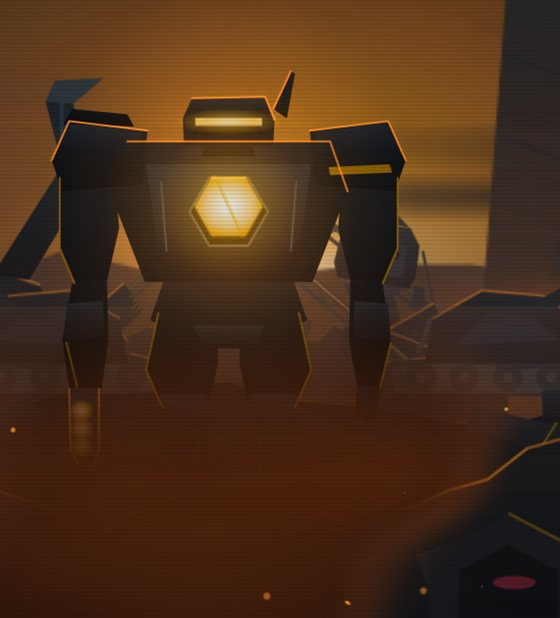
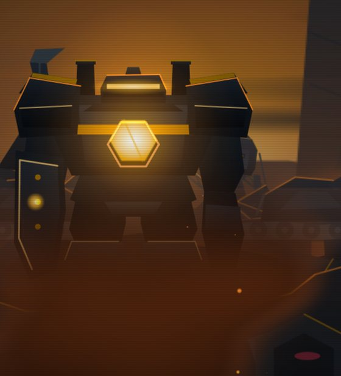
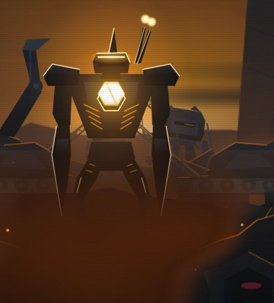
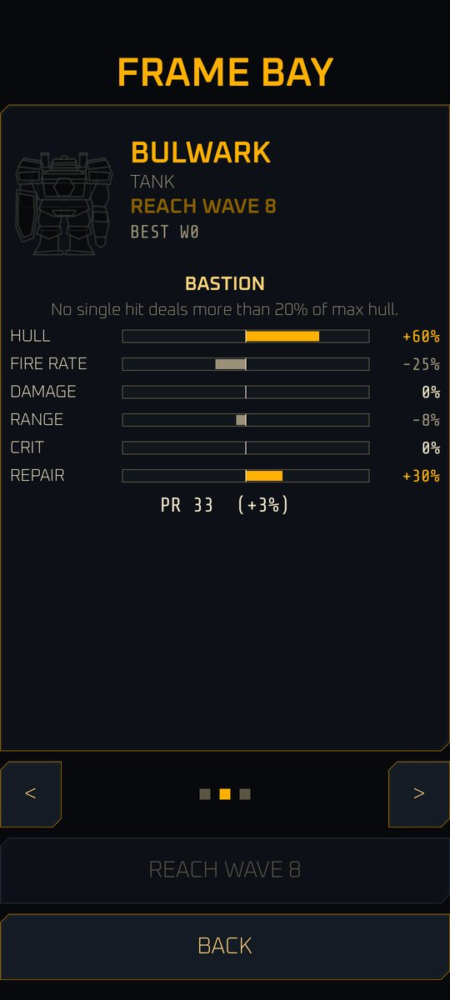
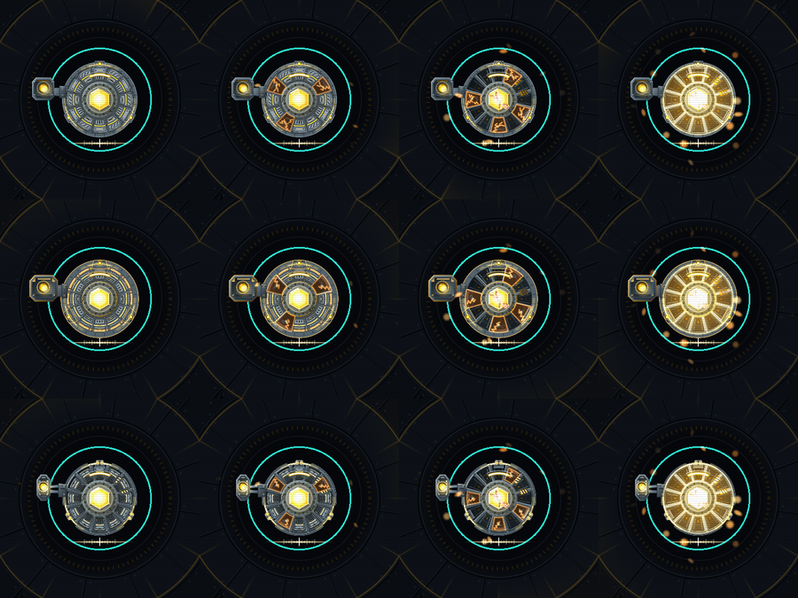

# Frames

A **frame** is the chassis configuration Cinder deploys in. Frames are **sidegrades, not upgrades**: each is stronger in one way and weaker in another, and the totals are balanced to stay comparable. A player may prefer a different frame depending on the situation.

Implemented VANGUARD, BULWARK and STRIKER, with the frame bay screen. Planned M6 SALVAGER and LONGSHOT.

!!! note "Choosing a frame today"
    The frame bay opens from **NEW GAME** on the title screen. A shortcut to it from Home is not in the build yet, so changing frame after you have unlocked more means starting a new game for now.

## The rules

- **Unlocked by play, never sold.** A frame unlocks when your best wave in Sector 1 reaches its threshold. A new profile has only VANGUARD.
- A frame's modifiers multiply Cinder's base stats first, then [Foundry](../systems/foundry.md) bonuses apply on top. The Foundry is shared: a Foundry level helps every frame.
- You choose the frame in the **frame bay**, never during a deployment. It is fixed for the whole deployment and recorded with it.
- Locked frames are shown in the bay as a dark outline with their goal (for example "REACH WAVE 8" and your "BEST W5") rather than hidden.
- Changing frame costs nothing and refunds nothing.
- When a run raises your best wave past a threshold, the results screen shows a "FRAME UNLOCKED: BULWARK" line.
- Each frame card compares the frame against your current one on six stats (hull, fire rate, damage, range, crit, repair) with bars and percentages, and shows a Power Rating (PR). The numbers are computed from the frame's data, not hand-written.

<figure markdown>

<figcaption>VANGUARD</figcaption>
</figure>
<figure markdown>

<figcaption>BULWARK</figcaption>
</figure>
<figure markdown>

<figcaption>STRIKER</figcaption>
</figure>

## The frames

| Frame | Role | Unlock (best Sector 1 wave) | Passive | Status |
|---|---|---|---|---|
| **VANGUARD** | Balanced baseline | Start | None | Implemented |
| **BULWARK** | Tank | 8 | Bastion | Implemented |
| **STRIKER** | Glass cannon | 15 | Overclock | Implemented |
| **SALVAGER** | Economy | 25 (placeholder) | Scrap Tithe | Planned M6 |
| **LONGSHOT** | Sniper | 40 (placeholder) | First Sight | Planned M6 |

### VANGUARD

The reference frame. Every multiplier is x1.0 and nothing is added, so balance for all other frames is measured against it. It is the only frame a new profile has. Its plates are the gunmetal and ceramic ones shown on the [Cinder](cinder.md) page.

### BULWARK

*Outlasts. Slow to kill.* A wider, heavier plate set with a broad shoulder block and bronze trim.

| Stat | Change |
|---|---|
| Hull integrity | x3.0 |
| Plating | +10 percent starting damage reduction |
| Nano repair | x1.3 |
| Cycle rate | x0.80 (slower fire) |
| Optic range | x0.92 |
| Laser output | x1.3 |

**Bastion:** no single hit deals more than 20 percent of Cinder's maximum hull (the share is a data value). A huge boss blow cannot take Cinder from healthy to dead in one hit.

It is strongest when you cannot, or do not want to, buy anything: its starting stats carry it, and in the balance runs it outlasts VANGUARD when nothing is bought.

### STRIKER

*Fast and fragile.* A slim, vented plate set with a twin emitter and white-hot trim.

| Stat | Change |
|---|---|
| Hull integrity | x0.50 |
| Nano repair | x0.7 |
| Laser output | x0.85 |
| Optic range | x0.80 (shorter reach) |
| Crit chance | +3 points |
| Cycle rate | x1.30 (faster fire, plus Overclock) |

**Overclock:** each kill adds +1 percent fire rate until the wave ends, up to +20 percent. The bonus resets at the start of the next wave. Both numbers are data values.

It is strongest when you are actively buying upgrades and killing fast, and in the balance runs it beats VANGUARD that way.

### SALVAGER Planned M6

*Slower kills, better income.* Scrap income x1.25, data income x1.10, laser output x0.85. **Scrap Tithe:** heavy kills (walkers, lancers, bosses) drop bonus scrap; exact numbers arrive with the frame.

### LONGSHOT Planned M6

*Reach and burst, slow cadence.* Optic range x1.33, laser output x1.4, cycle rate x0.6, with a doubled crit multiplier step. **First Sight:** the first shot at a newly acquired target always crits.

!!! note "About the numbers"
    Frame values come from the game's data table as of 2026-11-09 and are first-pass. The balance goal is that each frame's average death wave on a fresh profile lands within 10 percent of VANGUARD's, and that BULWARK beats VANGUARD when nothing is bought while STRIKER beats it with active buying. The latest measurement (40 runs) put BULWARK about 7 percent and STRIKER about 8 percent above VANGUARD on a fresh profile. With some Foundry levels the two frames pull further ahead of VANGUARD, which is still being looked at. Expect small changes.

## The frame bay

{ width="260" }

Swipe or use the arrows to browse the cards. SELECT picks an unlocked frame and saves the choice at once; on a locked card the button shows its goal instead. Back returns to the title screen.

## Looks

Each frame is a variant of the same layered Cinder rig, so every frame also burns through the four [exposure bands](../systems/skin-burn.md). From top to bottom the rows below are VANGUARD, BULWARK and STRIKER; left to right, intact to white-hot.

Back to [Characters](index.md).
