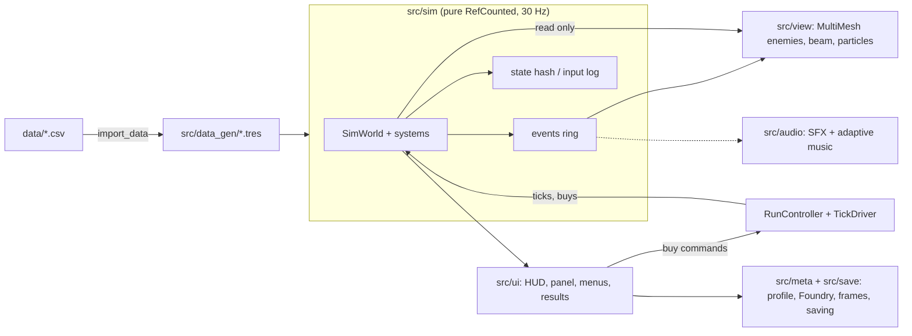

# Architecture

How the parts of IRON STATIC fit together. Rules and numbers live in the [design documents](https://github.com/paimonsoror/iron-static/tree/main/docs/design); the technical decisions behind this page are in [`TECH_ARCHITECTURE.md`](https://github.com/paimonsoror/iron-static/blob/main/docs/TECH_ARCHITECTURE.md).

## Deterministic simulation

The simulation runs at a fixed 30 Hz. It is pure `RefCounted` code: no nodes, no input, no clock and no global random, enforced by `tools\lint.ps1`. Randomness goes through a per-stream PCG32 `Rng`. Entities live in packed-array stores with free lists, so there is no node per enemy or bullet.

Game speed means more ticks per frame, never a longer tick. Every run produces a **state hash**, an **input log** (`tick, upgrade, count`) and a replay. Golden hashes in `tests/sim/test_replay.gd` catch any unintended change in behavior, and the same seed, config and inputs give the same hash at 1x, 2x or 4x. Any intended change to the rules bumps `SimVersion`.

Foundry levels, the chosen frame and the wave mode enter the simulation only as data in its config, and are recorded with the run, so replays stay valid.

## Numbers

`BigNum` (immutable, text form like `1.5e12`) holds currency and cost values, so late-game balances cannot overflow. `NumberFormat` is the only path to display. It floors to three significant digits and uses a suffix table.

## Saving

Profile and run saves share one container: a zstd-compressed payload with an HMAC-SHA256 signature over the header and payload, so truncation, corruption and tampering are detected on load. The signing key is embedded in the client; it stops casual file editing, not a determined reverse engineer.

- Writes go to a temporary file and are swapped in atomically. The previous good file is kept as a backup and used when the main file fails its checks.
- A damaged save raises a blocking "save problem" screen. The damaged files are renamed `.corrupt`, never deleted.
- Saves are written after every banked run, after Foundry and frame changes, and when the app goes to the background.
- A run snapshot is checkpointed every 30 seconds of unpaused play and restored, paused, after the app is killed. The game boots to the title screen and CONTINUE resumes it.
- Schema versions are migrated forward, with fixtures in `tests/fixtures/`. A snapshot from an older `SimVersion` is discarded (its data is banked) rather than replayed.

`src/save/` is pure code behind an injected filesystem interface, so all of it is unit-tested without touching the disk.

## Data pipeline

Balance and content live in `data/*.csv`: upgrades, enemies, sim constants, frames, Foundry rows, wave modes, UI strings and balance targets. `tools\import_data.ps1` generates typed `.tres` resources in `src/data_gen/`, which are the only data read on a device. Generated files are never edited by hand, and the importer rejects bad rows with a message that names the row.

## Rendering

- Compatibility (GLES3) renderer for broad Android support.
- Enemies are textured `MultiMesh` quads, one per enemy type. The MultiMesh carries only transforms; hit flash, flipbook frame and spawn-in come from a small per-instance data texture, because some mobile GPUs garble per-instance color data that changes every frame.
- Glow uses premultiplied alpha, so it costs one draw.
- The camera auto-fits, so Cinder's whole laser range is always on screen.
- The beam is a strip renderer; death bursts and sparks use a pooled GPU particle ring; the arena has an animated polar grid, a radar sweep and a vignette.
- Quality tiers HIGH, MID and LOW switch effects off in a fixed order, and glow strength drops as the crowd gets denser.
- Screen shake and the boss-death slow-motion are presentation only, and both can be turned off.

## Audio

Sound effects and music are synthesized offline by deterministic Python scripts in `tools/audio_gen/`; nothing is sampled.

- A bus layout (a Master limiter, Music, SFX and UI) and voice caps keep the mix clean.
- Music is four stacked eight-bar loops in an `AudioStreamSynchronized`. Layers fade in with the wave number, the presence of a boss and low integrity; the rules sit in `assets/audio/music_layers.csv`.
- Menus have a wind and distant-metal ambience.

## Mobile handling

- Safe-area insets for notches and cutouts.
- The run pauses when the app goes to the background and saves at once.
- A pure back-gesture policy: back closes an open panel, then pauses the battle, then quits. The edge swipe of gesture navigation is not mistaken for a tap.
- A 30 or 60 fps cap and a shader warm-up pass at boot.
- Layouts are checked on tall, wide and near-square windows (foldables).
