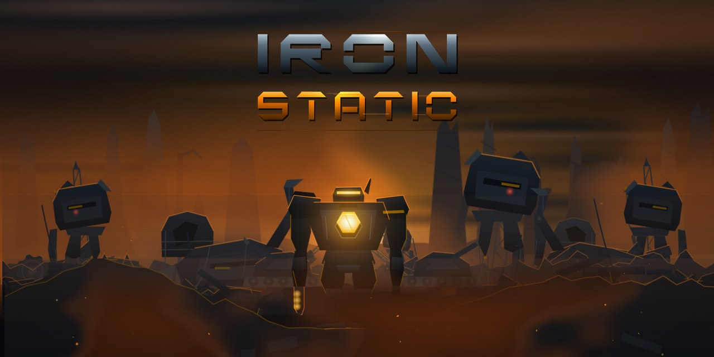
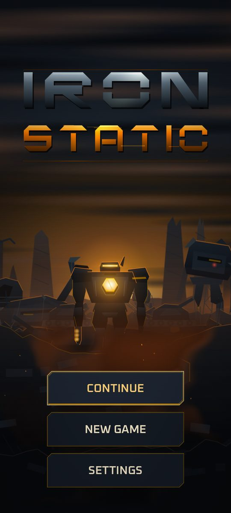
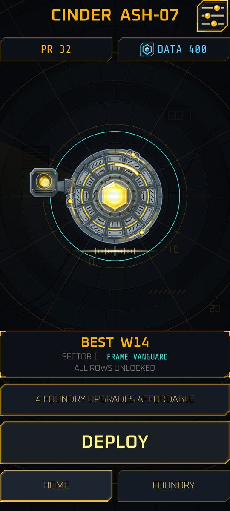
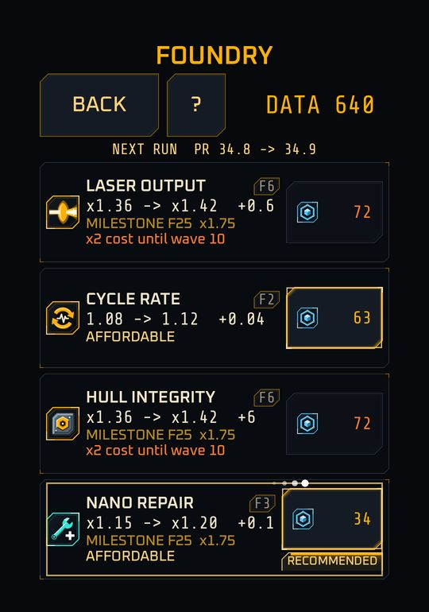
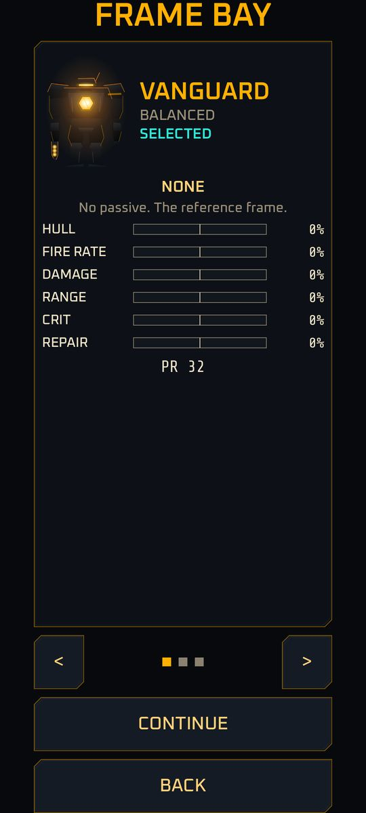
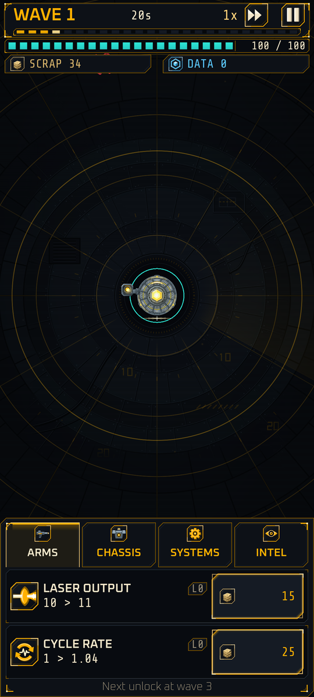
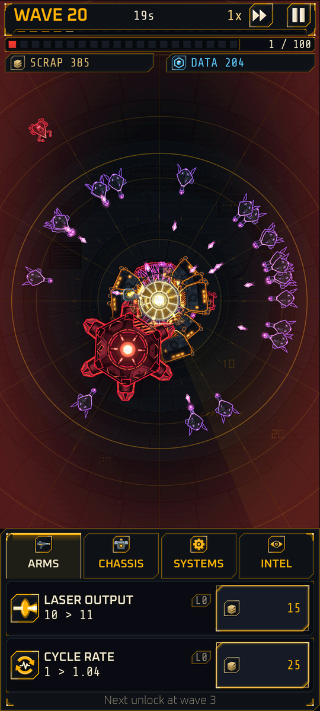
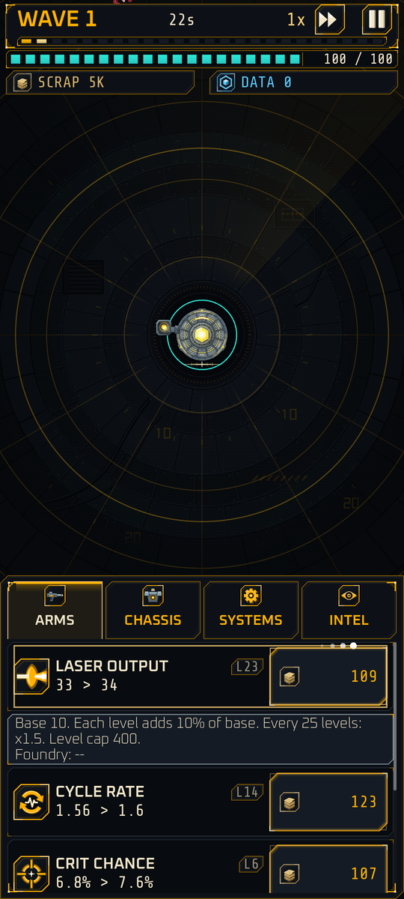
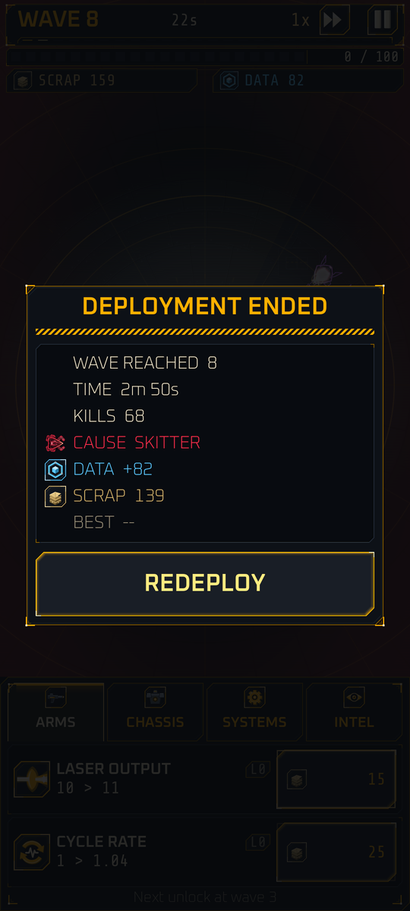

{ width="1280" }

Hold the last relay. Burn away what is left of being human. Go deeper every time.

**IRON STATIC** is a one-handed, portrait idle-defense game for Android. You are **Cinder**, a reprogrammed cybernetic combat unit fixed to the last working relay of a dead city. Rogue machine swarms pour in from every direction. Cinder fires a laser on its own. You choose what to buy: scrap-fed upgrades during a deployment, and permanent upgrades between deployments, so the next one goes deeper.

The look is a machine-vision targeting display: glowing vector lines, amber and red on black. As Cinder's integrity drops, its synthetic skin burns away and exposes the armored frame beneath.

This codex is the player-facing guide to the game: its story, its characters and every system. It is a first draft and it follows the game as it is built, so each feature carries a status badge.

<figure markdown>

<figcaption>The title screen</figcaption>
</figure>
<figure markdown>

<figcaption>Home, between deployments</figcaption>
</figure>
<figure markdown>

<figcaption>The Foundry spends banked data</figcaption>
</figure>
<figure markdown>

<figcaption>The frame bay</figcaption>
</figure>
<figure markdown>

<figcaption>Wave 1, a calm start</figcaption>
</figure>
<figure markdown>

<figcaption>Wave 20, lancers and the boss hulk</figcaption>
</figure>
<figure markdown>

<figcaption>Upgrades show their formulas</figcaption>
</figure>
<figure markdown>

<figcaption>Results after Cinder falls</figcaption>
</figure>

*Captures of the current build, downscaled. The menu screens were taken on a 1080 by 2400 phone-sized window with test profiles. The wave 20 shot is a debug scenario (invulnerable, fast-forwarded), so its crowd is denser than a real run.*

## Status badges

Implemented is in the current build. Planned is designed but not playable yet; the milestone is named next to it. See [Development status](status.md).

## Where to start

### The story
Who built the machines, who rewrote Cinder, and what the Relay is for.

[Read the lore](lore/index.md)

### The cast
Cinder, the selectable frames, and every enemy the swarm fields.

[Meet the characters](characters/index.md)

### The rules
Waves, combat, upgrades, economy, the Foundry, controls and more.

[Learn the systems](systems/index.md)

### Quick answers
Is it free? Are there ads? What can I do offline?

[Open the FAQ](faq.md)

## At a glance

| | |
|---|---|
| Platform | Android, portrait, one-handed |
| Genre | Idle defense with a deployment loop and permanent upgrades |
| Model | Free to play. Rewarded, opt-in ads only; no forced ads, no interstitials Planned |
| Wave length | 24 seconds at 1x speed |
| Your job | Buy upgrades, choose a build, decide when to retry. You never aim |
| Build today | The full loop: title screen, deployments with five enemy types, ten run upgrades and skin burn, results, the Foundry for permanent upgrades, three frames, settings and crash-safe saving with resume |
