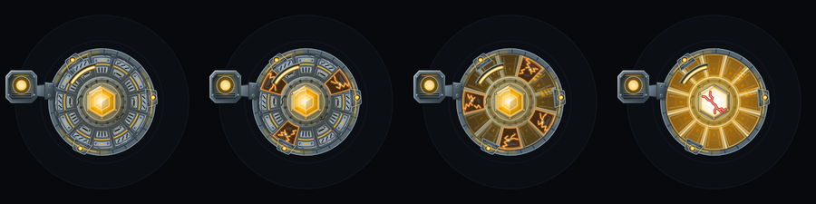

# What burns away

!!! draft "Draft lore: pending creator approval"
    This page interprets the game's central image. The mechanics are canon; the reading of them is a Draft extension awaiting approval.

> Hold the last relay. **Burn away what is left of being human.** Go deeper every time.

## The image

A Warden is an engineered organic core wrapped in synthetic skin over a combat frame. When Cinder takes damage, the skin does not simply fade. It **flickers, chars, sheds as embers and reveals the frame beneath**. At the worst point the exposed frame glows white-hot and the core shows through a cracked outline.

Integrity is the skin. Fighting well means losing it.

## What the game does with it

- **Four exposure bands** mark integrity at 75, 50 and 25 percent. Each has its own look and sound. See [Skin burn](../systems/skin-burn.md).
- The skin does not grow back as you go down, and re-forms one wedge at a time only when integrity recovers to a better band.
- From the Launch milestone, each lost band also gives a small comeback bonus: more damage and faster repair. Cinder gets *stronger* as it gets *less human*. Planned
- The second half of the tagline is about progress. Every permanent upgrade is a way of going deeper into the machine.

## The question the game never answers

Draft The design documents give Cinder an organic core but never say whose it was, or whether anything of that person remains. The directive "Hold the Relay" is all that was written over it. The theme is deliberately left open: *what is left of being human* is a quantity the player watches fall, band by band, and the game does not say what it was worth. There is no gore and no flashback; Cinder shows only light, ember and metal.

Back to the [Lore overview](index.md), or on to [Characters](../characters/index.md).
