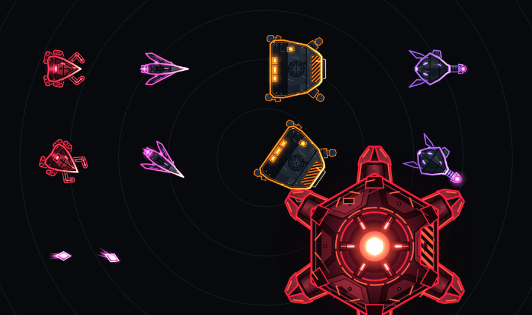
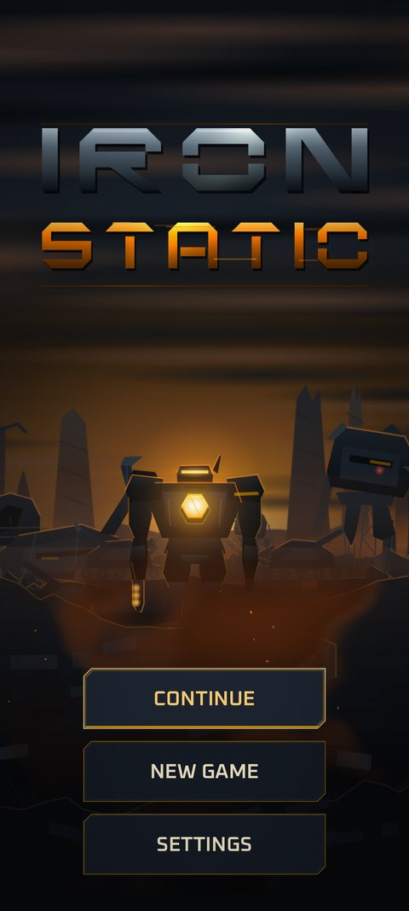

# Look and sound

Implemented

## Visual direction: machine-vision

The world is seen through Cinder's targeting optics: a dark void, an animated polar grid with range rings and a radar sweep, and amber readouts. The sprites are illustrated layered vector art with baked glow; beams, sparks, embers, rings and scanlines are effects drawn on top.

### The color rules

Colors carry meaning, and red is reserved:

| Color | Meaning | Hex |
|---|---|---|
| **Amber** | Cinder, information, anything you can afford | `#FFB000` |
| **Teal** | Friendly, healing, shields, flux | `#2EE6D6` |
| **Red** | Hostile and danger only | `#FF2D4B` |
| **Magenta** | Enemy fire only | `#FF4FD8` |
| Near-black | The void behind everything | `#07090C` |

Cinder is always the brightest, most saturated thing at the center; the swarm is darker, with bright outlines. Damage types have their own beam colors: laser amber-white, kinetic silver, arc cyan, blast orange, nano violet.

Currencies are color-coded too: scrap gold-tan, data blue, flux teal, cipher lilac, merit yellow.

### Effects

Hit flashes, kill bursts, muzzle and crit flares, embers from burning armor, a low-integrity red haze with a synced heartbeat, screen shake and a brief slow-motion on a boss or Cinder death. Effects scale down automatically on slower devices and are removed first in a fixed order.

### Performance

The game holds 60 frames per second with 165 enemies on screen on a Pixel 11 Pro Fold. Enemies are drawn in batches rather than as individual objects, which is why large swarms stay smooth.

## Title screen Planned M3

A smoky wasteland of metal and machines at dusk, with the selected frame silhouetted on a ridge with its core glowing, parallax layers, drifting smoke, rising embers, an occasional distant flare and a glitching logo. All motion switches off under reduce motion. The art exists; the scene is in production.

{ width="260" }

## Audio direction

Everything you hear is **original and synthesized**: sound effects and music are generated offline by deterministic scripts, not sampled or recorded.

- **Music:** ambient to industrial. Early waves are a calm cold-analog drone with sub-bass and pads. As waves climb, and during bosses and low integrity, industrial layers join: a filtered pulse, metal clanks, steel impacts, hydraulic hits and a glassy bell or low lead. Four layers stack and fade in with wave number, boss presence and low integrity. Tempo is about 90 BPM in a plain 4/4.
- **Sound effects:** a soft tick-zap for the laser (it plays constantly, so it must not tire the ear), metal hits, a bright ping for crits, thuds when Cinder is hit, a crackle at each skin-burn band, a heartbeat in the last band, a low pulse at wave start and a rising drone before a boss. Pitch varies slightly. Effects duck the music a little so they stay clear.
- **Upgrade buying** clicks up in pitch while you hold to repeat-buy.
- **Voice:** none. Cinder speaks only in terminal-style text lines.

Next: [Glossary](glossary.md).
