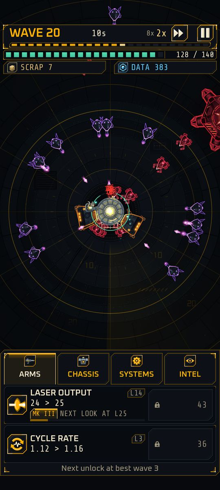
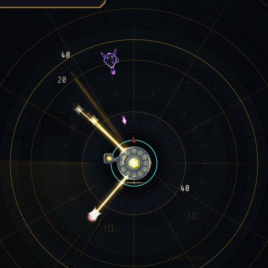

# Combat

Implemented

## The laser

Cinder's only weapon at the start is the **laser**: a hitscan beam, meaning it hits instantly and cannot miss a target in range. It is drawn as a line from the active emitter to the target. The bright core fades in a fraction of a second, a softer **afterglow** lingers for about 0.3 seconds, and a faint **scorch line** stays on the arena floor for about a second, so you can still read where the beam went between shots. Reduce motion shortens these effects but keeps them. The beam also grows with Laser Output: see [visual tiers](upgrades.md#visual-tiers).

| | Base value |
|---|---|
| Damage per shot (`laser_output`) | 10 |
| Shots per second (`cycle_rate`) | 1.0 |
| Range (`optic_range`) | 24 meters |
| Crit chance (`crit_chance`) | 2 percent |
| Crit multiplier (`crit_mult`) | x1.5 |

Damage types are tagged per source: `laser`, `kinetic`, `arc`, `blast` and `nano`. Only `laser` exists today; the rest arrive with weapon systems and matter for the [adaptive swarm](novel-mechanics.md#adaptive-swarm).

## Targeting

Cinder fires at the **nearest living enemy inside its range**, measured from the center. Ties go to the earliest spawn. The choice is made again on every shot; there is no lock-on.

Other targeting modes (ranged first, elites first, lowest health) are Planned M6 as research.

## Range

Range is how far Cinder can hit, 24 meters at the start and up to 80. The camera zooms so Cinder's whole range is always on screen. Range also controls where lancers stop to shoot: they hold at 85 percent of your range, between 16 and 48 meters, so more range both lets you hit them and pushes them back.

## Crits

Each shot rolls `crit_chance`. A crit multiplies damage by `crit_mult`. Crit chance is capped at 85 percent. Crits show a larger bracketed number (see [Damage numbers](#damage-numbers)) and a brighter flare. An overcrit tier (a rare second multiplier on top of a crit) is Planned M6.

## How a hit is calculated

For each shot the game applies, in order:

1. Base laser output, with your upgrade level and permanent bonuses.
2. Global multipliers.
3. The crit roll.
4. A minimum of 1 damage; overkill is discarded.

More steps (split shots, ricochet, standoff, armor tear, adaptation and field reductions) are Planned M6.

## Damage taken

When an enemy hits Cinder:

1. **Plating percent** removes a fraction of the damage, up to 90 percent.
2. **Flat plating** subtracts a fixed amount afterward Planned M6.
3. A **5 percent minimum** always gets through, so defense never makes Cinder immune.
4. The [skin burn](skin-burn.md#the-frame-hardens) band then multiplies what is left: x0.75, x0.55 or x0.35 in bands 1 to 3.
5. The rest comes off **integrity**.

Integrity returns slowly through `nano_repair`. Buying `hull_integrity` raises maximum integrity and heals by the same amount immediately.

### Death prevention Planned M6

A chain of save effects will fire in order when a lethal hit lands: a fail-safe roll, an aegis charge, a reboot, a meltdown and a purge, then an optional ad revive. Each logs a visible message so you know why you lived. Today, integrity 0 ends the deployment.

## What you see

The arena is a machine-vision display: an animated polar grid with range rings and a radar sweep. Enemies flash when hit and burst into shards when they die. Damage numbers rise from the hits: see below.

{ width="260" }

## Damage numbers

Implemented

<!-- Rules: src/view/damage_number_model.gd (show rules, merge, caps). -->

Numbers rise from enemies as you hit them, but only the ones worth reading:

- A hit shows when it is a **crit**, or when it is at least **1 percent of that enemy's maximum health**. Smaller hits on the same enemy within 0.2 seconds are summed into one number.
- At most six new numbers appear in any half second (the best ones win: crits first, then the biggest), and at most 24 are on screen at once, 12 on the lowest quality tier.
- Normal hits are cream, crits are larger, brackets and gold; damage **Cinder** takes is red and sits on Cinder; repair is teal with a plus. Each number lives 0.6 seconds, rises a little and fades. Every number has a dark outline so it reads over bright flashes.
- Reduce motion removes the rise and the pop-in; only the fade stays. At 4x and 8x speed fewer numbers are drawn.

{ width="360" }

A debug scenario at wave 9 (an invulnerable Cinder played by a bot): the cream numbers are hits on enemies, the red one is a hit on Cinder, and the beams still glow after the shot.

Next: [Run upgrades](upgrades.md).
