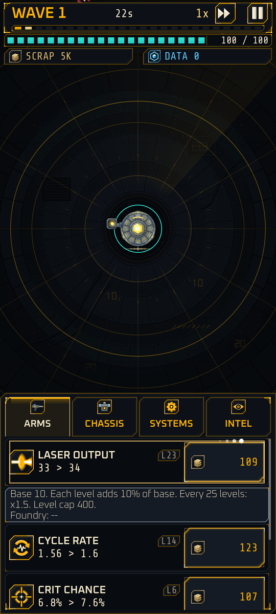

# Controls

Implemented

IRON STATIC is built to be played one-handed in portrait. **You never aim and the battlefield never needs a tap.**

## In a deployment

| Action | Input |
|---|---|
| Buy one level | **Tap** the cost button on a row |
| Buy many levels | **Hold** the cost button: repeat-buy that accelerates (first repeat after 0.35 s; 10 levels per step after 3 s; 100 per step after 6 s) |
| See a row's formula | **Tap the row** (anywhere but the cost button) |
| Switch panels | Tap **ARMS**, **CHASSIS**, **SYSTEMS** or **INTEL** |
| Change speed | The speed button in the top bar (1x and 2x; 3x and 4x will be unlocked by research) |
| Pause | The pause button in the top bar |
| Redeploy | The REDEPLOY button on the results screen |

Partial buys are allowed: if you cannot afford the whole amount you buy what you can.

{ width="260" }

## Android back gesture

The back gesture is handled in a fixed order:

1. If a panel or tooltip is open, **it closes it**.
2. Otherwise it **pauses** the battle.
3. Otherwise (already paused) it **quits** the app.

On the title screen the back gesture opens a **QUIT?** confirmation Planned M3.

## Leaving the app

When the app goes to the background, the **run pauses automatically** and stays paused behind a "PAUSED" overlay until you tap to resume. Sound is frozen at the same moment. Nothing advances while you are away; offline earning is a separate system (see [Standby Patrol](meta-planned.md#standby-patrol)). With saving (Planned M3), backgrounding also saves.

## Screen layouts

- **Portrait:** the battlefield fills the top of the screen and the upgrade panel the bottom, within reach of the thumb.
- **Wide:** on near-square screens such as a foldable's inner display, the panel docks to the right.

## Planned controls Planned

- **Overdrive button** (bottom-left of the field) and **weapon-system toggles** (bottom-right) in M6.
- **Tap a salvage cache** to pick its reward in M6.
- **Draft cards** at wave 10 and beyond in M4, with an optional auto-pick.

Next: [Look and sound](audio-visual.md).
