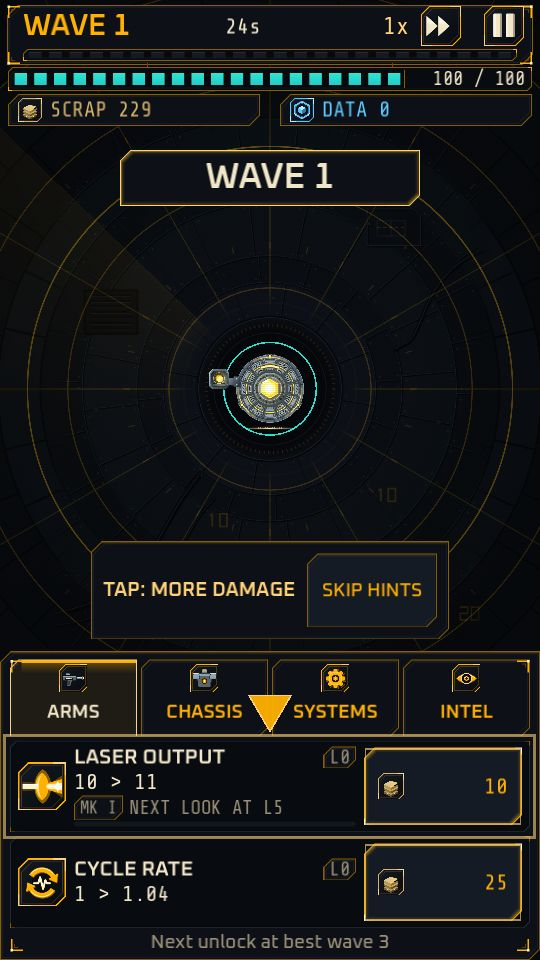

# Your first runs

Implemented

The game teaches itself in about ten minutes, with no text wall. The guidance is a handful of short beats that fire once, point at the thing to tap, and go away. All of it is optional.

{ width="260" }

The pointer on the first deployment, from a debug capture of a fresh profile at window resolution.

## The beats

<!-- Beats and their limits: data/ftue.csv. Text: data/strings_en.csv (ftue.*). -->

| When | What you see |
|---|---|
| NEW GAME on a fresh profile | A **cold open**: three amber lines (RELAY 06 ONLINE, HOSTILE SWARM DETECTED, HOLD THE RELAY) while Cinder fades in. A tap anywhere or the back gesture skips it. It shows once |
| Run 1 starts | A pointer on Laser Output: **TAP: MORE DAMAGE** |
| Scrap affords Cycle Rate | A pointer on Cycle Rate: **TAP: FIRE FASTER** |
| The first dart appears | A small label on it: **DART - FAST** |
| Cinder first takes damage | A pointer on Hull Integrity: **TAP: SURVIVE LONGER**, then **HOLD TO BUY SEVERAL** |
| The first patch draft | A note on the draft: "Patches last this deployment. One reroll per draft." See [Patch drafts](patches.md) |
| The first results screen | The FOUNDRY button gets a pointer: **FOUNDRY - UPGRADES STAY** |
| The first Foundry visit | A pointer on the Laser Output row and **HOLD TO BUY SEVERAL**. The Foundry also opens with a short explainer, which the **?** button reopens |
| Run 2 starts | A note: **FOUNDRY LEVELS CARRY OVER** |

Each beat shows in at most the first two or three deployments (data: `max_runs`), and ends for good once you have done the thing it points at. A **SKIP HINTS** button ends all of them at once. A beat never blocks the battle: the pointers let taps pass through.

Next: [Run upgrades](upgrades.md).
