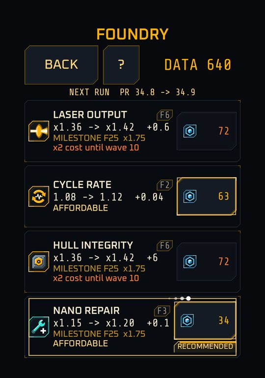
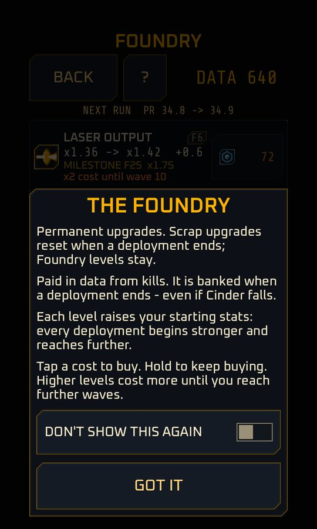

# The Foundry

<span class="badge live">Implemented</span> The Foundry screen, four rows, saving your levels, a best-wave soft cap and a short explainer. It opens once you have finished your first deployment. More rows are <span class="badge planned">Planned</span> for later milestones.

The **Foundry** is where **data** becomes permanent power. A Foundry level raises a stat's **starting value for every deployment**; you then add temporary run levels on top.

Two clear layers:

| Layer | Bought with | Lasts |
|---|---|---|
| Run levels | Scrap | One deployment |
| Foundry levels | Data | Forever |

## How a stat is resolved

```text
final = base * run factor * Foundry multiplier * other multipliers
```

Other multipliers include the [frame](../characters/frames.md) you chose. Foundry levels do not count toward a run upgrade's level cap, and the Foundry is shared by all frames.

## The four launch rows

| Row | Kind | Per-level factor `f` | Foundry level cap | Base cost `fc0` | Cost growth |
|---|---|---|---|---|---|
| Laser Output | D | 0.06 | 200 | 20 | x1.10 |
| Hull Integrity | D | 0.06 | 200 | 20 | x1.10 |
| Nano Repair | D | 0.05 | 200 | 25 | x1.10 |
| Cycle Rate | C | step of the run row (+0.04) | 50 | 50 | x1.12 |

More rows follow with later milestones.

## Formulas

**Cost** of the next level, in data:

```text
foundry_cost(F -> F + 1) = ceil(fc0 * fg ^ F)
```

**Type D rows** (Laser Output, Hull Integrity, Nano Repair) multiply:

```text
foundry_mult(F) = (1 + f * F) * 1.75 ^ floor(F / 25)
```

Every 25 Foundry levels is a x1.75 milestone. The row shows the next one, for example "MILESTONE F25  x1.75", and the Foundry recommends the cheapest row that is about to reach one.

| Foundry level | Laser Output or Hull multiplier | Total data to reach it (fc0 = 20) |
|---|---|---|
| 10 | x1.6 | 319 |
| 25 | x4.4 | 1,967 |
| 50 | x12.3 | 23,278 |
| 100 | x65.7 | 2.76 million |

**Type C rows** (Cycle Rate) add instead: a Foundry level is a free starting run level, up to half of the run cap (so Cycle Rate has 50). The run cap is not raised.

**Unlocking** a row that is gated by best wave costs a one-time amount of data, about 20 times its run base cost.

## What the screen shows

{ width="260" }

<sub>A test profile at best wave 8: Laser Output and Hull Integrity are over the cap ("x2 cost until wave 10").</sub>

The top of the screen shows your **DATA** and a preview line, "NEXT RUN PR a -> b", with the Power Rating change your purchases would give. Each row shows its level (`F8`), its current and next value with the change, the next milestone (`F10  x1.25`), the cost, and whether it is affordable now or "~N TO AFFORD" at your current earn rate. A **RECOMMENDED** tag marks the cheapest stat within three levels of a milestone, or else the cheapest affordable row; a row held back by the soft cap is never recommended. **Tap** the cost button to buy a level; **hold** to repeat-buy, the same way as in a deployment. There is no buy-mode selector. Buying saves your profile. **Tap a row** (anywhere but the cost button) for its tooltip: the first line says in plain words what the stat improves (the same sentence as the run upgrade, listed in [Run upgrades](upgrades.md#what-each-upgrade-improves)), followed by the permanent-bonus rules, the next price and the cap.

You reach the Foundry from Home (a chip tells you how many rows you can afford) and from the results screen. DEPLOY on the Foundry starts the next run directly. Back returns to the screen you came from. Until you finish your first deployment the Foundry is hidden.

## The best-wave soft cap

<span class="badge live">Implemented</span>

<!-- Numbers: data/sim_constants.csv rows foundry_cap_k, foundry_cap_min, foundry_over_cap_mult, foundry_over_cap_growth. Rule: docs/design/05 s1.5. -->

Data arrives faster than waves do, so stacking one stat early would run far ahead of what the rest of the build can use. The Foundry therefore makes levels cost more when you are ahead of your best wave. It is never a lock.

```text
limit = max(6, floor(0.7 * best TIMED wave))
cost of a level at or above the limit = normal cost * 2
```

At best wave 0 the limit is 6 levels, at wave 10 it is 7, at wave 35 it is 24 and at wave 100 it is 70.

- A row over the limit shows its cost in orange and a line such as "x2 cost until wave 10": the best wave at which that level costs the normal price again. The cost button stays enabled.
- **Hold-to-buy** stops at the first over-limit level. A fresh tap buys one level at the higher price and the hold can continue from there.
- Levels you already own are never removed. If you are above the limit you keep them and pay double for more until your best wave catches up.
- Only your best TIMED wave in Sector 1 counts, the same value that gates upgrades and frames.
- The affordable-upgrades count on Home and Results includes only rows at the normal price.
- The **?** button reopens the Foundry explainer (below), a short dialog that opens each time you enter the Foundry until you choose DON'T SHOW THIS AGAIN, and ends with "Higher levels cost more until you reach further waves."

{ width="260" }

## Design target

A new player should be able to spend their first banked data on two or three stats and feel the difference on the next run, aiming for several more waves per 300 data. The balance targets for a fresh profile with patch drafts are a median death wave of about 14, about 20 with 300 data spent and about 27 with 1,000 data (`data/targets.csv`, first-pass).

Next: [Saving and resuming](save-resume.md).
