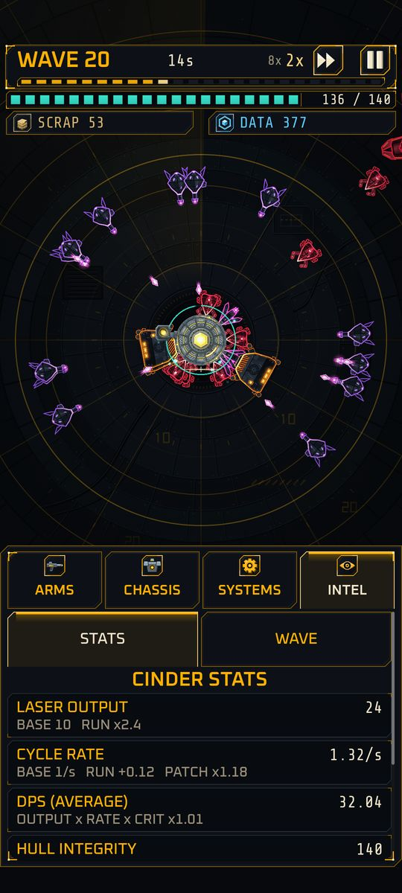
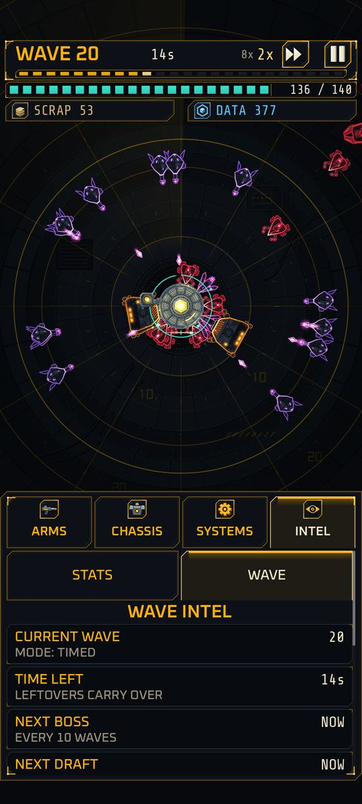

# Intel

Implemented

**Intel** is the fourth tab of the upgrade panel, next to ARMS, CHASSIS and SYSTEMS. It changes nothing; it shows what the game is using, so no number is hidden. It has two sub-tabs, **STATS** and **WAVE**.

| | |
|:-:|:-:|
| { width="260" } | { width="260" } |
| STATS, the top of the list | WAVE, at wave 20 in TIMED mode |

Both are debug scenarios: an invulnerable Cinder played by a bot to wave 20 (the speed control shows the fall-back, see [Controls](controls.md#game-speed)).

## STATS

One row per visible upgrade, each showing the **final value the game uses** and the chain that made it.

- Type D rows (Laser Output, Hull Integrity, Nano Repair) read `BASE x RUN x FOUNDRY x FRAME x PATCH`. Type C rows read `BASE + RUN + FOUNDRY`, then the frame and patch multipliers. Links that change nothing are left out, and a row with no modifiers says NO MODIFIERS.
- **DPS (AVERAGE)** follows Cycle Rate: output times rate times your crit factor.
- **DATA YIELD** is always shown. **ENEMY DAMAGE** appears only when a patch such as HARDHIDE has changed it.
- **BURN HARDENING** is last. It shows how much less damage Cinder takes in its current [skin burn](skin-burn.md#the-frame-hardens) band, for example "-45%" in band 2 with a line naming the band, or NONE and "SKIN INTACT: FULL DAMAGE". The [skin burn page](skin-burn.md#the-frame-hardens) has a picture of it.

## WAVE

- **CURRENT WAVE**, with the mode.
- **TIME LEFT** in TIMED mode ("LEFTOVERS CARRY OVER"), or the **QUOTA** of enemies left and the backstop in PURGE mode.
- **NEXT BOSS** and **NEXT DRAFT**: how many waves away they are, or NOW. See [Patch drafts](patches.md).
- **ENEMY SLOTS** for the next wave, and how many are for normal enemies when a boss comes.
- **STALE ENEMIES**: how many are alive, and the share of the normal reward they pay (half).
- The **expected enemy mix** of the current wave: one row per enemy type with its share, and its hit points, attack, speed and slot cost at the current enemy level.

Planned M6 The adaptive-swarm resistance bars and active wave conditions will arrive in this tab. See [Novel mechanics](novel-mechanics.md).

Next: [Run upgrades](upgrades.md).
