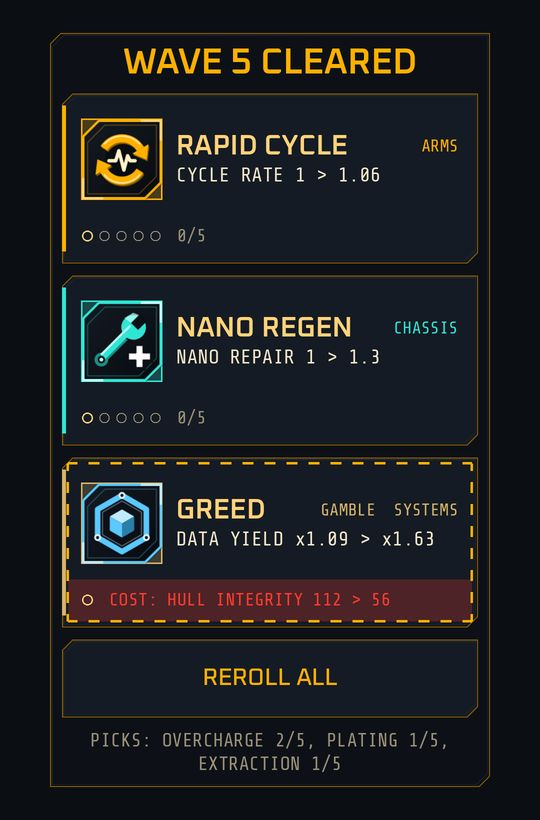

# Patch drafts

Implemented

At fixed waves the game stops and offers three **patches**: temporary perks that last the rest of the deployment. A **draft** is one such moment. Patches are a second layer of choice in a run, on top of what you buy with scrap.

{ width="260" }

The wave 5 draft with a gamble card, rendered by a debug harness over a plain backdrop. Some picks are already held, so the pick line is filled.

## When a draft opens

<!-- Schedule: data/sim_constants.csv rows draft_first_wave, draft_interval, draft_interval_after, draft_interval_mid, draft_interval_mid_after, draft_interval_late. -->

A draft opens when you clear waves **5, 10, 15 and 20**, then every 10 waves up to wave 50 (**30, 40 and 50**), then every 25 waves (**75, 100, 125** and so on). The Wave panel of the [Intel tab](intel.md) shows how many waves are left until the next one. The schedule is the same in TIMED and PURGE mode.

The battle is frozen while the draft is open. There is no timer and no auto-pick. Opening the pause menu, or the app being killed, does not lose the draft: it is still open when you resume.

## What a draft offers

- **Three cards, one per family**, in the order ARMS, CHASSIS, SYSTEMS. A patch belongs to the family of the stat it changes, which is the tab of that stat in the upgrade panel.
- Each card shows the patch name, the **concrete change for this run** (for example "CYCLE RATE 1 > 1.06"), and **pick pips**: how many times you hold this patch against its maximum.
- Now and then a **gamble** replaces the card of its family (about 15 percent of offers). A gamble has a dashed border, a GAMBLE tag and a red-tinted line with its cost.
- **REROLL ALL** redraws all three cards, once per draft. After you use it the button reads REROLLED.
- A patch you hold the maximum number of times is not offered again. If a family has nothing left to offer, a card from another family fills its slot.
- A line under the cards lists the picks you hold, such as "PICKS: OVERCHARGE 2/5, PLATING 1/5".

Offers are drawn from the run's seed, so the same seed with the same choices gives the same drafts, rerolls included.

## The patches

<!-- Numbers: data/patches.csv. Names: data/strings_en.csv (patch.*). -->

Standard patches can be taken up to five times and add to their stat for each pick.

| Patch | Family | Effect per pick | Max picks |
|---|---|---|---|
| OVERCHARGE | ARMS | Laser output +9% | 5 |
| RAPID CYCLE | ARMS | Cycle rate +6% | 5 |
| PLATING | CHASSIS | Hull integrity +12% | 5 |
| NANO REGEN | CHASSIS | Nano repair +30% | 5 |
| CERAMIC | CHASSIS | Plating +2.5 points | 5 |
| EXTRACTION | SYSTEMS | Scrap yield and data yield +9% | 5 |

**Gambles** can be taken once. Each shows a benefit and a cost, and both apply for the rest of the deployment.

| Gamble | Family | Benefit | Cost |
|---|---|---|---|
| GLASS CANNON | ARMS | Laser output x1.35 | Hull integrity x0.7 |
| GREED | SYSTEMS | Data yield x1.5 | Hull integrity x0.5 |
| HARDHIDE | CHASSIS | Enemy damage x0.6 | Laser output x0.6 |

Patches end with the deployment: they do not carry into the next one. Their effect shows in the Intel Stats chain as `PATCH`.

## Planned

Patches that change how the weapon behaves rather than a number, an optional auto-pick, and Lab research that offers more cards or shortens the gaps between drafts are designed for later milestones. See [Lab, Arsenal and Standby Patrol](meta-planned.md).

Next: [Intel](intel.md).
