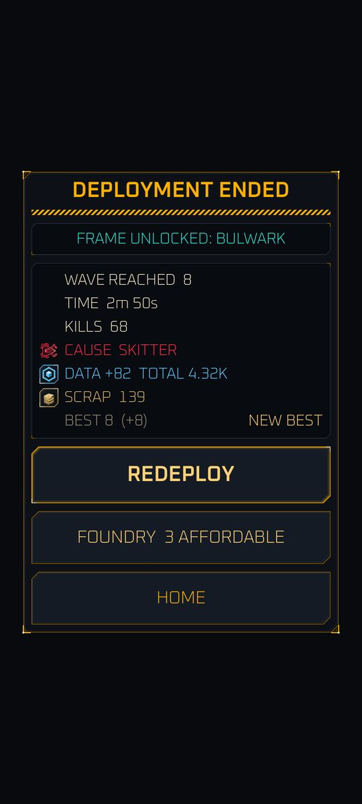
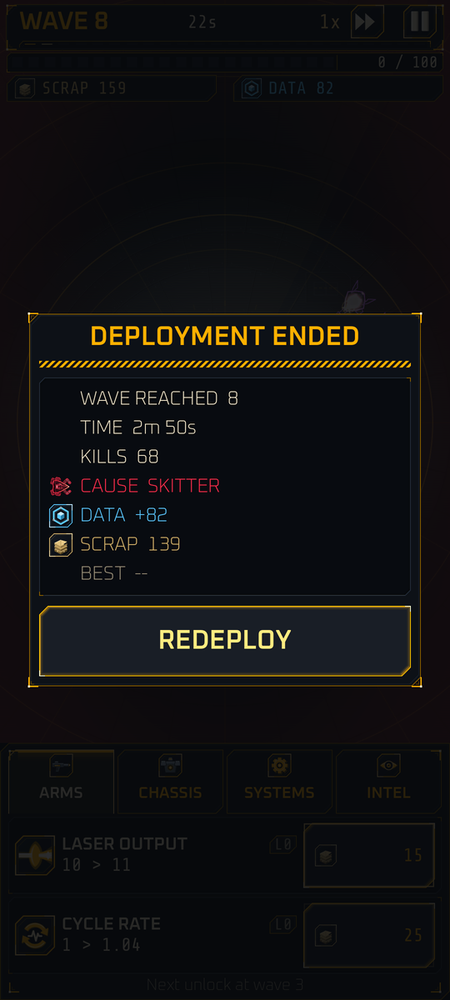

# The run loop and waves

<span class="badge live">Implemented</span>

## A deployment

One attempt at holding the Relay is a **deployment** (a run).

1. **Start.** Cinder appears at the center of the arena with 60 scrap. Every run upgrade is at level 0.
2. **Waves.** The game is a sequence of waves. In TIMED mode each wave is 24 seconds; in PURGE mode a wave ends when its enemies are destroyed (see [Wave modes](#wave-modes)). Enemies spawn at the edge and walk in.
3. **Combat.** Cinder fires on its own at the nearest enemy in range. Kills pay scrap instantly and add data to the run total.
4. **Spend.** You buy upgrades from the bottom panel with scrap. See [Run upgrades](upgrades.md).
5. **End of wave.** Interest is paid and the enemy level rises (see below).
6. **Death.** When integrity reaches 0 the deployment ends. The results screen shows the wave reached, time survived, kills, cause of death, the data banked (and your new total), scrap, and your best wave in the mode you played, with the gain ("BEST 12 (+3)", plus "NEW BEST" when you beat it).
7. **Redeploy.** One tap starts the next deployment with a new seed. The results screen also has FOUNDRY (showing how many upgrades you can afford) and HOME, and a "FRAME UNLOCKED" line when your best wave unlocks a frame.

{ width="260" }

What you keep and lose at death:

| | |
|---|---|
| **Data** | Banked in full, even on death, and saved to your profile |
| **Scrap** | Lost |
| **Run upgrade levels** | Lost; the next run starts at level 0 |
| **Best wave** | Kept, one record per mode. The TIMED best decides which upgrades and frames you have unlocked, and when PURGE unlocks |

Typical run length at 1x speed is 2 to 4 minutes for a first run, about 8 to 12 minutes after a week, and 15 to 25 minutes for deep runs, which are normally played at 2x.

{ width="260" }

## Wave modes

<span class="badge live">Implemented</span>

<!-- Mode numbers (20, 60 s) come from data/wave_modes.csv. Update this section if that file is retuned. -->

You pick a **wave mode** on Home, in a two-segment picker above DEPLOY. There are two modes.

| | TIMED | PURGE |
|---|---|---|
| **Available** | From the start | After your best TIMED wave reaches 20 |
| **A wave ends** | When the 24-second clock runs out | When every enemy in the wave is destroyed |
| **Time limit** | The 24-second clock | 60 seconds, so a wave can never stall |
| **Between waves** | Next wave starts on the clock | Next wave starts at once, no pause |
| **Rewards per kill** | Standard | The same |

- **TIMED** is the default and is preselected on a fresh profile. It is the game as described in [Wave timing](#wave-timing).
- **PURGE** ends a wave when the boss (if there is one) and every other enemy that spawned in it are destroyed, and all the wave's planned spawns have appeared. The next wave starts immediately. If 60 seconds pass first, the wave ends anyway and leftovers carry over, just like a TIMED wave end.
- On the HUD, PURGE shows **"N LEFT"** (enemies of this wave still to destroy) and a thin bar for the 60-second limit.
- **Locked PURGE.** Until you unlock it, the PURGE segment reads "Reach wave 20 in TIMED to unlock" and shows your best TIMED wave so far. A one-time "PURGE MODE UNLOCKED" chip appears when you reach it.
- **Remembered choice.** The game remembers your last mode, and REDEPLOY repeats it.
- **Separate records.** Each mode keeps its own best wave. Home and Results show the record of the mode you are in, with NEW BEST for that mode. Only the TIMED best unlocks upgrade rows and frames.
- **Offline earnings.** The planned Standby Patrol will use the TIMED earning rate.

First-pass balance runs on a fresh profile put the median death wave at about 12 in TIMED and about 16 in PURGE. PURGE waves average about 33 seconds against TIMED's 24. These numbers may change.

Patch drafts (below) are planned to use the same wave numbers in both modes.

## Wave timing

This section describes TIMED mode. In PURGE the wave clock only acts as the 60-second limit. Each TIMED wave lasts **24 seconds at 1x speed**: an 18-second spawn phase followed by a 6-second lull. At the default 30 ticks per second, a wave is exactly 720 simulation ticks.

- **The next wave starts when the timer ends** in TIMED, whether or not enemies remain. Slow down and they stack up.
- During the lull nothing spawns. A SKIP LULL button is <span class="badge planned">Planned</span> (Launch; unlocked by research).
- A boss wave comes every 10 waves. The HUD shows a chevron one wave ahead.
- Game speed is 1x or 2x today and the engine supports up to 4x. Speed changes how many ticks run per frame, never the length of a tick, so results are identical at any speed.

## How many enemies spawn

Each wave has a spawn budget of **slots**:

```text
slots(w) = min(200, floor(4 + 2.4 * w^0.6))
```

Wave 1 has 6, wave 10 has 13, wave 50 has 29 and wave 100 has 42. Enemies cost slots (a walker costs 3), and the game draws enemy types by weight until the budget is spent, allowing an overflow of up to 2 slots.

| Enemy | Spawn weight | First wave |
|---|---|---|
| Skitter | 100 | 1 |
| Dart | 30 | 4 |
| Lancer | 22 | 6 |
| Walker | 18 | 8 |

New types ramp in over 10 waves after their first wave. Boss waves add the boss at about 2 seconds in and run the normal swarm at 60 percent size.

Spawn times are spread across the 18-second spawn phase. About 60 percent of enemies come from random angles; about 40 percent arrive in **flank groups** of 3 to 6 within plus or minus 10 degrees, so you can read the clumps.

At most 160 normal enemies and 8 bosses can be alive at once.

## Enemy scaling

Enemies have an **enemy level** that starts at 1 and rises by 1 at the end of every wave. A sector adds 25 levels per step (Sector 2 starts at level 26).

```text
enemy_hp     = 14 * G_hp(level)  * hp_mult(type)
enemy_damage =  2 * G_atk(level) * dmg_mult(type)
```

| Level range | Health growth per level | Attack growth per level |
|---|---|---|
| 1 to 200 | 6.3 percent | 5.8 percent |
| 201 to 600 | 3.2 percent | 2.8 percent |
| 601 and up | 2.2 percent | 1.8 percent |

Health roughly doubles every 11 levels at first. Attack grows a little slower than health at every stage, so survivability stays relevant.

### Melee bite and stale enemies

- A melee enemy that keeps hitting Cinder hits 3 percent harder with each consecutive hit, up to x2.0.
- An enemy that survives **three wave ends** is **stale** and pays only half its scrap and data. This discourages stalling.

## Rewards per kill

```text
scrap = max(1, round(2 * G_hp(level)^0.55)) * scrap_mult(type) * scrap yield
data  = data_base(type) * (1 + 0.04 * level) * sector reward * data yield
```

Scrap tracks enemy health at a slightly lower exponent on purpose: the run is a race that you eventually lose. The sector reward is 1.6 to the power of (sector minus 1).

## The wave counter and Intel

Tapping the wave counter will open the **Intel** view with enemy weights, health, attack and speed per type. The tab exists today as a stub ("coming in a later update"); the full panels are <span class="badge planned">Planned M4</span>.

## Patch drafts <span class="badge planned">Planned M4</span>

At waves 10, 20, 30, 40 and 50 (then every 25 waves) the game will pause and offer three **patches**: temporary perks that last the deployment. Most are straight bonuses (for example +15 percent laser output); some are gambles that show a benefit and a cost, such as +50 percent laser output for 30 percent less hull. You pick one; there is no reroll.

Next: [Combat](combat.md).
