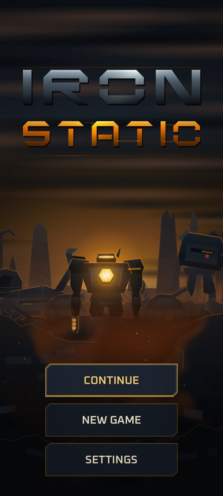

# Saving and resuming

!!! planned "Planned: milestone M3"
    The save format, the crash-safe writer and the run checkpoint are built and tested in the engine. The screens that use them (title, Home, Foundry) are in production, so today's build keeps nothing between launches.

## What will be saved

- **Your profile:** banked data, Foundry levels, best wave, unlocked frames, the selected frame, run counters and settings.
- **Your current run,** while one is in progress, so it can be resumed.

## When it saves

- After a deployment ends and its data is banked.
- Whenever you buy a Foundry level or select a frame.
- When the app is paused or sent to the background. Android can end a backgrounded app with no warning, so saving is done at that moment.
- During a run, a **checkpoint every 30 seconds** and on pause.

## Resuming after the app is closed

If the app is closed or killed in the middle of a deployment, **CONTINUE** on the title screen resumes it. The run comes back **paused behind an overlay**; tap to carry on. Because the simulation is deterministic, a resumed run continues exactly as it would have.

A run that is closed with the back gesture or backgrounded is simply paused. See [Controls](controls.md).

## Protecting your save

Saving is built to survive crashes, power loss and bad writes:

- The file is written to a temporary copy first, then swapped into place in one step, so a half-written file cannot replace a good one.
- The previous good save is kept as a backup. If the main file fails its checks, the game falls back to the backup.
- Saves carry a checksum and a signature, so corruption and tampering are detected. A damaged save is reported to you; it is not silently discarded.
- Save files carry a version number and are migrated forward when the game updates.

## New Game and resetting

- **NEW GAME** on a profile with no progress goes straight to frame selection.
- On a profile **with** progress it first asks **"START OVER? THIS ERASES YOUR PROGRESS."** If you confirm, the old files are **renamed to `.reset` copies, not deleted**, so an accident can be recovered through support. Your settings (sound, shake and so on) are kept because they are device preferences.
- **Settings > Data** also has a reset, behind **two** separate confirmations. The second names how much data and which best wave you are about to lose.

## Title screen flow

```text
title ── CONTINUE ──> Home (or straight back into a resumed run)
      ├─ NEW GAME ──> (confirm if progress exists) ──> frame bay ──> Home ──> DEPLOY
      └─ SETTINGS
```

CONTINUE only appears when a save with progress exists; a fresh install shows only NEW GAME and SETTINGS. The back gesture on the title opens a **QUIT?** confirmation.

{ width="260" }

*Title screen artwork from the current production pass, with the selected frame silhouetted on a ridge.*

## Cloud save <span class="badge planned">Planned M7</span>

Accounts, cloud save and conflict handling are planned for the online milestone, after the save format is frozen.

Next: [Novel mechanics](novel-mechanics.md).
