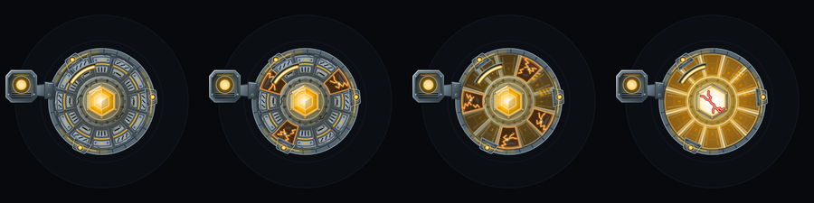

# Skin burn

Cinder's armor plates burn away as its integrity drops, exposing the frame underneath. It is the game's signature image and the clearest way to read how close Cinder is to falling.

Implemented The four visual bands. Planned M6 The gameplay bonuses.

## The four bands

Let `f` be integrity divided by maximum integrity.

| Band | Integrity | What you see | Comeback bonus (Planned) |
|---|---|---|---|
| **0** | Above 75% | Armor intact: all twelve plates, a steady core | none |
| **1** | 50% to 75% | **Scorch.** Three plates char and flake; ember particles and small sparks | +6% damage, +20% nano repair |
| **2** | 25% to 50% | **Exposed.** Eight of the twelve plates are gone; frame ribs show; the display flickers | +12% damage, +40% nano repair |
| **3** | 25% or below | **White-hot.** The frame glows white-hot, the core shows through a cracked outline, a heartbeat pulses and a red vignette closes in | +18% damage, +60% nano repair |

The band label and a crackle sound mark each change. In the worst band a heartbeat sound pulses in time with the low-integrity haze.

## Hysteresis

Bands change with **5 percent hysteresis**: you only leave a band after integrity has crossed the threshold by another 5 percent. That stops the look flickering between two bands when integrity hovers near a line.

## Going back up

Plates do not grow back while integrity is falling. When integrity recovers to a better band, they **re-form one by one over about 1.5 seconds**.

## The bonuses

From the Launch milestone each band lost gives Cinder more damage and faster repair. The idea is a comeback mechanic: the more the skin burns, the harder Cinder hits. Today the bands are visual only; the numbers above are planned.

A patch (Planned) will scale the bonuses and start the burn 5 percent lower.

## Why it matters

Integrity is invisible in most idle games: a number on a bar. Here you can see it from across the room. For the story reading, see [What burns away](../lore/burning-away.md).

Next: [Economy and currencies](economy.md).
