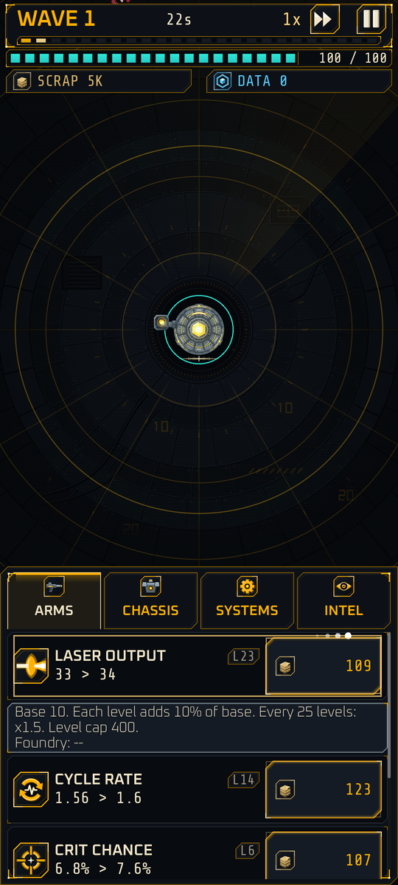

# Run upgrades

<span class="badge live">Implemented</span> (10 upgrades)

Run upgrades are **temporary**. You buy them with scrap during a deployment and they reset to level 0 when it ends. Permanent versions of the same stats come from the [Foundry](foundry.md).

{ width="260" }

## The panel

The bottom of the screen is the upgrade panel with three tabs (and an Intel tab, still a stub).

| Tab | Purpose |
|---|---|
| **ARMS** | Offense |
| **CHASSIS** | Defense |
| **SYSTEMS** | Economy and utility |

Each row shows an icon, the name, your level (`L0`), the current value and the next value, and a cost button on the right. Cost text is amber when you can afford it and dim when you cannot; it is never red, because red means hostile.

Rows you have not unlocked are not shown. A single line at the bottom says "Next unlock at wave N". Rows unlock by **best wave** (see the table).

## Buying: tap and hold

- **Tap** the cost button to buy 1 level.
- **Hold** it to repeat-buy. The first repeat comes after 0.35 seconds and speeds up. After 3 seconds each step buys 10 levels; after 6 seconds, 100. The buy sound steps up in pitch while you hold.
- **Partial buys** are allowed: if you can afford only 7 of 10 levels, you buy 7. A buy only fails when not even one level is affordable.
- **Tap a row** (anywhere but the cost button) to open its formula tooltip: base value, step, caps and the Foundry bonus. Nothing is hidden.

## The ten upgrades

| Upgrade | Tab | What it does | Base | Per level | Level cap | Hard cap | Cost to buy level 1 | Cost growth | Unlocks at best wave |
|---|---|---|---|---|---|---|---|---|---|
| Laser Output | ARMS | Damage per shot (type D) | 10 | x(1 + 0.10 L) | 400 | none | 15 | x1.09 | start |
| Cycle Rate | ARMS | Shots per second (type C) | 1.00 | +0.04 | 100 | 12.0 | 25 | x1.12 | start |
| Crit Chance | ARMS | Chance a shot crits | 2% | +0.8 points | 98 | 85% | 60 | x1.10 | 5 |
| Crit Mult | ARMS | Crit damage multiplier | x1.50 | +0.05 | 150 | none | 80 | x1.085 | 8 |
| Optic Range | ARMS | Firing range in meters | 24 | +0.4 | 100 | 80 | 40 | x1.10 | 10 |
| Hull Integrity | CHASSIS | Maximum integrity; buying also heals (type D) | 100 | x(1 + 0.10 L) | 400 | none | 15 | x1.09 | start |
| Nano Repair | CHASSIS | Integrity restored per second (type D) | 1.0 | x(1 + 0.10 L) | 400 | none | 20 | x1.09 | start |
| Plating | CHASSIS | Percent damage reduction | 0% | +0.5 points | 99 | 90% | 100 | x1.10 | 10 |
| Scrap Yield | SYSTEMS | Multiplier on all scrap gained | x1.00 | +0.02 | 100 | x3.0 | 50 | x1.10 | 3 |
| Reinvest | SYSTEMS | Interest on unspent scrap at wave end | 0% | +0.06 points | 99 | 5.94% | 300 | x1.11 | 12 |

(The first-level cost shown is the cost at level 0. Gates use your best wave in Sector 1.)

## The formulas

**Cost.** The price of the next level, paid in scrap:

```text
cost(level -> level + 1) = ceil(c0 * g ^ level)
```

For laser output (c0 15, g 1.09) the first levels cost 15, 17, 18 and so on; level 10 costs 36 and level 25 costs 130. Multi-level buys add the exact costs in sequence, with no discount.

**Type D (deep) upgrades** scale hard. They grow linearly with each level and also jump by **x1.5 every 25 levels** (the overclock milestone, marked with a gold ring on the row):

```text
run_factor(L) = (1 + 0.10 * L) * 1.5 ^ floor(L / 25)
```

| Level | Factor | Laser output |
|---|---|---|
| 0 | x1.0 | 10 |
| 10 | x2.0 | 20 |
| 25 | x5.25 | 52.5 |
| 50 | x13.5 | 135 |
| 100 | x55.7 | 557 |

Type D applies to Laser Output, Hull Integrity and Nano Repair. **Type C (capped linear)** upgrades add a fixed step per level and stop at a hard cap.

Permanent bonuses multiply the final value: `final = base * run factor * Foundry multiplier * frame and other multipliers`. See [The Foundry](foundry.md).

## What each upgrade is for

- **Laser Output and Cycle Rate** are your damage. Output is the deep, scalable one; rate is capped at 12 shots a second.
- **Crit Chance and Crit Mult** reward volume. They multiply each other, so neither is worth much without the other.
- **Optic Range** hits lancers and darts sooner, and lets Cinder shoot while enemies are still far away.
- **Hull Integrity and Nano Repair** are survival. Hull also heals when bought, so buying armor mid-fight is a small heal.
- **Plating** is a percentage shield with a hard 90 percent cap, so integrity stays relevant.
- **Scrap Yield** raises income. **Reinvest** pays interest on what you have not spent, up to half of that wave's kill scrap, so it rewards saving.

## Reinvest in detail

At the end of each wave Reinvest pays `floor(unspent scrap * rate)`, capped at half of the scrap earned from kills that wave. Every payout is rounded down to whole scrap and the fraction carries over, so nothing is lost or invented.

## Planned upgrades <span class="badge planned">Planned M6</span>

About 40 more rows are designed: split shots, ricochet, burst fire, standoff damage, overcrit, armor tear, razors, shock rings, mines, spike return, siphon, barricades, repair pods, free levels, data yield and signal lag. See [Novel mechanics](novel-mechanics.md) and the [Glossary](glossary.md) for names.

Next: [Skin burn](skin-burn.md).
